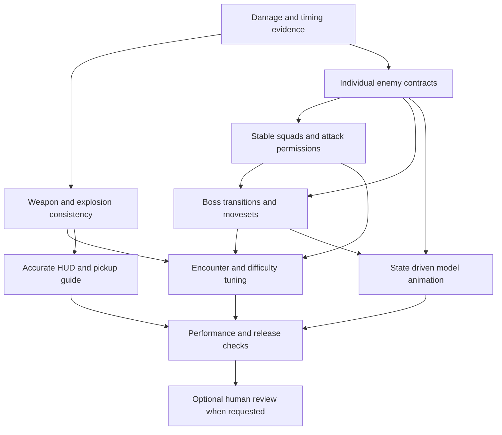

# PLOUTO: Detailed Game Improvement Plan

**Created:** 2026-11-16, Asia/Dhaka. **Updated:** 2026-11-17.

**Status (2026-11-17):** Source implementation is recorded for all 37 ledger tasks. Source and release are simulation-rules version 12; the transactional release rebuilt the 0.1.0 Rust bundle and friend ZIP. The full review manifest has 474 files, including all 224 archived Python files; the friend ZIP has 85 entries and excludes source, reports, benchmarks, and local data. The latest full headless suite passes 155 tests with one adapter-dependent GPU test ignored. Two rules-12 P01 profiles match all 30 checkpoints; 112-actor p95 is 0.89–1.21 ms, below the 16.67 ms step budget but not consistently below the plan's 1 ms target. Character size/proportion and preview-frame changes have offline eight-heading evidence; final GPU lighting/camera review and human play remain unverified. Core AI systems are implemented, with per-role acceptance, boss prediction, and robust player-exposure fairness evidence still open in `ENEMY_AI_PLAN.md`. Gamepad support (gilrs 0.11) and 35 achievements are present but have not been checked on hardware or in live play. Android touch support is a layout hypothesis only. No game window, new sector, or sound work was added.

**Purpose:** Turn the existing Rust game into a more readable, varied, deliberate arena survival game while preserving its artwork, proper rotating 3D characters, open arenas, and fast combat.

**Execution constraint:** Do not launch or interactively test the game unless the user asks. The user now allows headless tests (`cargo test -p plouto_rs`); agents still do not launch the game. Source inspection, compile checks, headless test runs, and release builds are allowed. This document itself does not authorize a live play session.

**Sound:** Excluded. No music, effects, sound production, or sound-driven feedback work belongs to this roadmap.

## Execution ledger

Task IDs below map one-to-one to the 37 ordered backlog items in section 28. “Implemented” records code that has landed; it does not imply scenario, visual, human-play, or release evidence that has not been gathered.

| ID | Task | Current state |
| --- | --- | --- |
| C01 | Resolved damage records | Implemented; compile checked; focused scenario verification pending |
| C02 | Deterministic simultaneous player hits | Implemented; strongest same-step hit wins with stable ties; focused scenario verification pending |
| C03 | Nearest swept projectile collision | Implemented; ordered intersections and same-step pierce processing; focused scenario verification pending |
| C04 | Single-use explosive retirement | Implemented; shared shell retirement and contact-point centers; focused scenario verification pending |
| C05 | Clock ownership inventory | `docs/design/SIMULATION_CLOCKS.md` inventories player/world, enemy, presentation, projectile, hazard, event, score, and scheduler clocks; enemy attack staggering now uses accumulated Time Slow-scaled enemy time; compile checked; focused clock scenarios pending |
| C06 | Attack interruption cleanup | Repulsor stun and boss phase-change cancellation implemented; focused scenario verification pending |
| C07 | Detailed replay fingerprint | Implemented versioned full-state fingerprint including accumulated enemy time, sorted map hashing, 300-frame and final checkpoints, first-divergence reporting, legacy v1–v3 hash paths, and strict rules-version rejection; current simulation-rules version 12; full replay regression passes |
| C08 | Transactional release archives | The staged transactional v12 build passed: full review manifest has 474 files; both rules-12 profiles match checkpoints; source, character/Android reports, and both character sheets are included; all 224 Python archive files remain; friend ZIP has 85 entries and excludes development sources/reports/data. |
| W01 | Shared timed-effect metadata | Implemented in simulation metadata; gameplay timers, HUD rings, rarity and guide durations now share definitions; compile checked |
| W02 | Practical weapon damage ledger | Added source-derived formula ledger for all eight weapons; runtime hit-rate measurement deferred |
| W03 | Temporary weapon reload and swap rules | Implemented rank-safe temporary replacement, base restoration, inherited reload debt, and useful conversion for equal/lower-rank drops; compile checked; focused scenario evidence pending |
| W04 | Bounded explosive interaction budgets | Implemented per-step chain-hop ceiling; Flak fragment count and critical-shard pool remain bounded; compile checked |
| W05 | Contact and mobility matrix | Implemented per-target boost ram cooldown, explicit boss/stun contact handling and a safe dash-direction fallback; compile checked |
| E01 | Enemy behavior sheets | Added `docs/design/ENEMY_BEHAVIOR_SHEETS.md` for all 11 roles; fixed Flyer dash timeout and stale launch warnings; compile checked |
| E02 | Bomber and Tank cue agreement | Implemented normalized state cues, exact blast-radius target marker, and guide updates; compile checked; final visual review pending |
| E03 | Bounded enemy evasion | Implemented 0.16s evasion responses and role-specific cooldowns on enemy time; committed attacks suppress evasion; compile checked |
| E04 | Stable squad slots | Formation slots persist through local membership changes and reuse vacancies; compile checked; crowd scenario evidence pending |
| E05 | Attack permission scheduler | Implemented for regular enemy attacks with weighted commitment capacity, same-role start staggering, and a paced forced grant after sustained denial; Charger, Spitter, and Sniper two-slot reservations now persist across scheduler frames; compile checked |
| E06 | Mixed crowd clearance | Implemented deterministic mixed-role overlap separation with fixed anchors and a per-enemy displacement budget; compile checked; scenario evidence pending |
| E07 | Swarm subgroup cycle | Three spawn-keyed subgroups keep independent staggered cycles and lanes; added a shared-state 0.30s surge tell to movement and floor-ring rendering; compile checked; movement/crowd/visual evidence pending |
| E08 | Egg and summon capacity | Budget-aware egg hatches, legal separated placement search, and central pending-spawn caps are implemented; pre-deadline owner death cancels an egg hatch, while committed queued children survive independently; compile checked; capacity/owner-death evidence pending |
| B01 | Shared boss transition rules | Implemented shared phase/rage result, unlaunched-action cancellation, 0.35s phase reset, boss-owned hazard cleanup, and one-time reward-flow audit; compile checked |
| B02 | Storm and Prisma passes | Implemented predictable parallel storm lanes and a warned final-phase prism fan tied to wing articulation; compile checked; fight evidence pending |
| B03 | Forge and Brood passes | Forge spike markers already match committed positions; Matriarch now marks exact legal summon positions; central spawn budget applies; compile checked |
| B04 | Gorgon and Ocular passes | Implemented arena-shape-aware charge lanes, bounded phase-III follow-up charge, phase-II pulse, and removed the Ocular's non-damaging phantom pulse cue; compile checked |
| B05 | Origin and Eclipse passes | Made paired Origin warning/damage traps atomic and tied Eclipse heading, model rotation, and safe sector to one locked direction; compile checked; visual evidence pending |
| L01 | Encounter templates and unlock sequence | First 20 wave-class combinations authored with fixed unlocked-class fallback; seeded class-member and count selection retained; source compile checked |
| L02 | Event compatibility table | `docs/design/LEVEL_DESIGN_AND_DIFFICULTY.md` records the single-event budget, boss exclusion, warning/damage geometry, expiry, and open-lane limits; scenario review pending |
| L03 | Difficulty calibration report | Source formula modifiers and projected counts documented in `docs/design/LEVEL_DESIGN_AND_DIFFICULTY.md`; multi-seed/player-policy measurement deferred |
| V01 | Character specification sheets | `docs/design/CHARACTER_ART_SPECIFICATIONS.md` records reference silhouette ratios, attachment locks, palette, scale/collision relationships, and heading constraints for the player, 11 enemies, and 8 bosses; final GPU review pending |
| V02 | State-driven animation mapping | `docs/design/ANIMATION_STATE_MAP.md` maps attack state to articulated poses and reduced-motion behavior; Chaser facing now follows its committed lunge and Bomber no longer spins independently of travel heading; visual review pending |
| V03 | Explosion and shake mixer | Same-frame shake impulses now use strongest-impact arbitration and per-source ceilings instead of additive stacking; screen shake retains the existing capped decay and accessibility scale; final effect review pending |
| U01 | HUD state and layout pass | Status line now prioritizes a responsive number of cues and summarizes overflow; buff rings continue to use shared power-up timers and Ultra uses its radial cooldown fill; visual matrix pending |
| U02 | Focus and transition input | Screen changes clear held/queued combat input; duplicate key-down activation is suppressed; compile checked |
| U03 | Communication queue and guide accuracy | Urgent boss, hull, arena, and relic lines preempt lower-priority text and reveal fully with wrapping; routine guidance keeps its type-on treatment; reduced-motion mode shows all text immediately; pending comms are deduplicated and priority ordered; guide timing copy remains tied to shared definitions; visual review pending |
| P01 | Profile and optimize measured hotspots | Current rules-12 release profiles cover authored wave 14, authored boss wave 15, and 24/64/112-actor mixed-role stress cases; all 30/30 state checkpoints match across two runs. The 112-actor p95 is 0.89–1.21 ms across those runs: one meets the plan's 1 ms target and one narrowly exceeds it, while both remain far below the 16.67 ms simulation-step budget. Rendering/full-frame performance remains unmeasured. |
| R01 | Save location and release manifest | Installed builds resolve to user data with safe one-time legacy copying; portable/custom locations are supported; v12 manifests record source provenance, executable identity and per-file hashes. The review bundle and friend ZIP were rebuilt and validated after the current documentation/profile updates. |

The no-launch rule remains in effect. Headless tests, deterministic simulation profiles, compile checks, and release packaging are allowed; the latest `cargo test -p plouto_rs` run passed 155 tests with one adapter-dependent GPU test ignored. These results do not establish live GPU appearance, whole-frame performance, hardware input feel, or human-play balance.

**Follow-up and remaining work (2026-11-17):**
- Typed roles, perception, regular attack director, formation v2, and unified locomotion are implemented. The AI plan records the narrower remaining work: per-role acceptance audit, boss prediction migration, persistent telemetry, authored-wave profiles, and a representative moving-player hit sample.
- Enemy and boss 3D model modularization is complete. Offline character sheets and the current art audit are recorded in `docs/reports/CHARACTER_RENDER_AUDIT.md`; GPU and live combat animation review remain open.
- Gamepad support landed (gilrs 0.11; see [GAMEPAD.md](../design/GAMEPAD.md)). It has not been tested on real hardware.
- The achievements overhaul landed: 35 achievements, including 15 new ones, with progress lines and secret entries (see [ACHIEVEMENTS.md](../design/ACHIEVEMENTS.md)). Open policy questions: abandoned or quit runs count toward runs-played achievements, and daily retries count as runs.
- The Android touch-control layout hypothesis is documented; touch input and device validation remain unimplemented.

## Contents

1. [Product direction and boundaries](#1-product-direction-and-boundaries)
2. [Current implementation and evidence](#2-current-implementation-and-evidence)
3. [Priority and delivery rules](#3-priority-and-delivery-rules)
4. [Simulation contracts and architecture](#4-simulation-contracts-and-architecture)
5. [Damage and collision](#5-damage-and-collision)
6. [Cooldowns and attack scheduling](#6-cooldowns-and-attack-scheduling)
7. [Player movement and survivability](#7-player-movement-and-survivability)
8. [Weapons and explosives](#8-weapons-and-explosives)
9. [Every pickup and its interactions](#9-every-pickup-and-its-interactions)
10. [Enemy behavior framework](#10-enemy-behavior-framework)
11. [All regular enemy designs](#11-all-regular-enemy-designs)
12. [Squads, swarms, and positioning](#12-squads-swarms-and-positioning)
13. [Boss encounter framework](#13-boss-encounter-framework)
14. [All eight boss plans](#14-all-eight-boss-plans)
15. [Wave and difficulty design](#15-wave-and-difficulty-design)
16. [Open arena and event design](#16-open-arena-and-event-design)
17. [Progression, rewards, and builds](#17-progression-rewards-and-builds)
18. [Artwork, proportions, and model rules](#18-artwork-proportions-and-model-rules)
19. [Animation and attack readability](#19-animation-and-attack-readability)
20. [Projectiles, bombs, and camera effects](#20-projectiles-bombs-and-camera-effects)
21. [Menus and interface](#21-menus-and-interface)
22. [HUD and animated communication](#22-hud-and-animated-communication)
23. [Accessibility and controls](#23-accessibility-and-controls)
24. [Performance and resource limits](#24-performance-and-resource-limits)
25. [Replay, saves, and release quality](#25-replay-saves-and-release-quality)
26. [Measurement and verification](#26-measurement-and-verification)
27. [Implementation phases](#27-implementation-phases)
28. [Ordered implementation backlog](#28-ordered-implementation-backlog)
29. [Risk register and decision log](#29-risk-register-and-decision-log)
30. [Completion and handoff](#30-completion-and-handoff)

## 1. Product direction and boundaries

### 1.1 The desired experience

The player should make quick, understandable decisions: where to move, which threat to remove, when to spend an ability, when a dangerous opponent is committed, and whether a pickup is worth the movement risk. Those decisions should change as enemy combinations and bosses change. The game should remain responsive when a wave becomes crowded.

Power should come from the results of an action. An explosive weapon should visibly clear a meaningful area, leave a clear reload window, and stop shaking the camera after its impact. A boss should look dangerous because its shape, preparation, and committed movement explain the attack. A swarm should create pressure through positioning and coordinated dives, with paths the player can read.

### 1.2 Rules carried forward from the user's instructions

- Rust remains the active desktop implementation and release target.
- The Python implementation remains an archive, outside the active player distribution.
- Preserve proper 3D models. Rotate actual model geometry through world headings; do not attach a permanently visible face to a flat screen-facing shape.
- Preserve the established character artwork as the source of identity, silhouette, palette, and proportions.
- Keep the arena open. Do not reintroduce cover obstacles, crates, walls, or constructions that block player travel as a shortcut to level variety.
- Preserve clear projectile ownership and gameplay information under bloom and effects.
- Keep powerful pickups brief, meaningful, and controlled by explicit timing rules.
- Every implementation pass gets a Markdown report entry with actual changes, verification, limitations, and artifacts.
- Do not start interactive game testing without a new user request.
- Do not add sound work.

The Donut arena's central opening and other existing arena boundaries are geometry constraints. Preserving those shapes does not authorize placing new obstacles inside playable lanes.

### 1.3 What “better” means in measurable terms

1. A damaging attack has a known source, a preparation cue where appropriate, an active interval, and a recovery interval.
2. Damage and visual impact use the same geometry and timing definitions.
3. A unit's intended role is visible in its behavior and remains intact under squad steering.
4. Powerful temporary effects have a useful action budget, an accurate timer, and an understandable expiration.
5. Difficulty increases decisions and coordination while retaining minimum readable warning windows.
6. More enemies do not automatically produce a permanent circle of unavoidable contact.
7. Menu actions, aiming, movement, and resource gauges use consistent mappings.
8. Geometry remains stable across headings; faces disappear behind the hull when they should.
9. Release archives contain the current executable and required assets, with no personal saves.
10. Evidence describes its actual scope. A headless simulation cannot establish that a boss feels fair to a human.

### 1.4 Explicit restraint on expansion

Improve the current eight primary weapons, 17 pickup categories, 11 regular enemy types, and eight bosses before adding another large content roster. The late-game Siege Mortar is an adopted new role because the requested short-window, large-area bombardment did not exist in the prior seven-weapon arsenal. Multiplayer, online accounts, procedural campaigns, crafting, an equipment inventory, and a new engine are outside this plan.

## 2. Current implementation and evidence

### 2.1 Source baseline

This plan is based on the current workspace, not the older Python game. The main source areas are:

| Area | Current files | Why they matter |
| --- | --- | --- |
| Desktop flow and input | `plouto_rs/src/app.rs`, `main.rs` | Fixed updates, screen transitions, input conversion, launching and recording |
| Main combat update | `sim/step.rs` | Shooting, damage, explosions, contacts, spawning and rewards |
| Tunable values | `sim/config.rs`, `weapons.rs`, `level.rs` | Intervals, limits, weapon definitions and difficulty values |
| Enemy decisions | `sim/behaviors.rs`, `enemy.rs`, `steer.rs` | Individual behavior states, swarm controller and formation correction |
| Bosses | `sim/bosses.rs` | Eight encounters, phase transitions, rage and attack states |
| Secondary systems | `sim/powerup.rs`, `specials.rs`, `drone.rs`, `rpg.rs` | Timed effects, chains, recoil interactions, relics and temporary rewards |
| Arena logic | `sim/math.rs`, `events.rs`, `hazards.rs`, `layout.rs` | Boundaries, event geometry, hazards and legacy obstacle support |
| Art and rendering | `render/models3d.rs`, `player_art.rs`, `world.rs` | Rotating models, effects, world composition and projection |
| Interface | `ui/hud.rs`, `screens.rs`, `hangar.rs`, `theme.rs` | Gauges, callouts, menu flow and accessibility presentation |
| Persistence | `save/*`, `sim/replay.rs`, `assets.rs` | Save migration, score records, replay verification and file discovery |
| Distribution | `build_all.bat`, `tools/package_friend.ps1` | Release and friend archive production |

Full paths in this document are relative to the workspace root. Shorthand paths beginning with `sim/`, `render/`, `ui/`, or `save/` refer to folders inside `plouto_rs/src`; unqualified Rust filenames refer to the relevant source area in the same row or paragraph. Sections describing future modules use proposed names; they do not imply those files already exist.

### 2.2 Existing systems that should be preserved

- The game has a deterministic simulation and recorded input replay verification.
- Individual enemies and all eight bosses have real 3D model render paths.
- Formation steering already separates some roles and avoids overriding several committed attack states.
- Swarm units have encircle, surge, and regroup modes and a dedicated overlap correction.
- Regular enemies unlock through staged waves; bosses occur every fifth wave.
- The game already includes temporary weapon pods, relics, skins, achievements, mutators, daily runs, and boss rewards.
- Ultra has a cooldown fill ring. Timed buffs have duration rings. The weapon chip now shows shot reload progress.
- Defensive settings include reduced motion, screen shake choices, color-aware palettes, and high contrast HUD support.
- The latest recorded full Rust test run passed 59 tests: 11 library tests, 28 render/UI tests, and 20 simulation/save tests.

The test count is a record of the previous implementation pass. This planning pass does not rerun the suite or assert a fresh runtime result.

### 2.3 Current weapon baseline

All damage figures in this table are weapon-definition values, not final damage after the player damage formula, critical hits, relics, or extra effects.

| Weapon | Base damage per projectile | Projectiles per volley | Base interval | Relevant current behavior |
| --- | ---: | ---: | ---: | --- |
| Basic Gun | 10 | 1 | 0.28s | Single straightforward projectile |
| Heavy Cannon | 20 | 1 | 0.95s | Missile, 112-unit radial blast, 0.70s minimum interval |
| Rapid Fire | 6 | 1 | 0.12s | Faster fire with wider cadence variation |
| Hyper Railgun | 40 | 1 | 0.50s | Fast projectile with piercing |
| Spread Shot | 8 | 3 | 0.35s | Three directions with broad spacing |
| Plasma Rifle | 9 | 3 | 0.26s | Center projectile plus two side projectiles |
| Flak Battery | 11 | 3 | 1.10s | Three cluster shells, 76-unit blast per shell, 0.85s minimum interval |
| Siege Mortar | 32 | 1 | 1.45s | Late-wave ground lock, 168-unit blast, 1.30s minimum interval, 5s pickup |

At default player damage, projectile damage includes an additional term in `compute_player_raw_damage`. For example, a weapon-definition value of 9 currently becomes 14 before critical handling and other scaling. Any balance spreadsheet must reproduce the actual formula rather than treating the table as final hit damage.

### 2.4 Current timing baseline

| Effect | Current duration or timing | Planning consequence |
| --- | --- | --- |
| Heavy Cannon weapon pod | 8s | Evaluate complete volleys actually available during the window |
| Flak weapon pod | 6s | Evaluate three-shell overlap and the reload at acquisition |
| Siege Mortar weapon pod | 5s; 1.45s base interval, 1.30s minimum | Check target choice, travel delay, blast value and volleys as separate outcomes |
| Railgun and Plasma weapon pods | 12s | Compare useful output against lighter pods |
| Other weapon pods | 20s | Preserve identity without assuming equal duration means equal value |
| Ion Beam | 5s, pulses every 0.32s | Keep independent from the equipped weapon's cadence |
| Singularity | 6s, radius 110 | Measure close-range exposure and useful targets covered |
| Wingman Drone | 8s | Measure first-shot delay and target acquisition waste |
| Ricochet | 6s | Measure usefulness on all four boundary shapes |
| Homing | 5s | Check range and turn-rate interactions |
| Chain | 5s | Audit propagation and secondary trigger limits |
| Time Slow | 4s, enemy time scale 0.5 | Verify all enemy-owned timers follow the intended clock |
| Magnet | 10s | Keep utility duration distinct from offensive burst windows |
| Boost Overdrive | 6s | Check boost energy restoration and timed benefit together |
| Ultra | 10s base cooldown | Resource charges and cooldown readiness remain separate |
| Repulsor | 12s cooldown | Queue handling must not discard a stored charge |
| Player damage grace | 0.08s | Investigate source ordering and independent attacks |
| Bomber windup | 0.60s | Target lock and visible cue must agree |
| Bomber bomb fuse | 1.25s | Flight speed currently derives from locked target distance |
| Tank cannon windup | 0.48s | Formation steering must preserve the committed lane |
| Charger active timeout | 1.15s | Preserve recovery when boundary clamping prevents arrival |

### 2.5 Confirmed gaps in the strength of current evidence

Earlier replay fingerprints used selected aggregate state. Replay format 4 uses a comprehensive fingerprint of ordered projectile, enemy, player, hazard, resource, progression, and timer state, with deterministic map ordering and strict simulation-rules version checks. The current simulation-rules version is 6 after rank-safe Weapon Pod handling and the coordinated swarm surge warning. These paths are compile-checked, but replay round-trip, mismatch, and legacy-file behavior have not been exercised in this pass.

The existing six-second mixed roster run covers a useful sample, including all arena shapes and difficulties, but it cannot prove late-wave squad stability over arbitrary movement or large crowd sizes. A final-frame clearance assertion also cannot prove no earlier overlap occurred.

The latest reload bar and explosive balance pass has not been inspected in a newly launched game, in accordance with the user's instruction. Previous live captures are historical visual references.

Existing boss tests show phase progression and attack emission. They do not yet prove a reachable escape route exists through every overlapping attack combination.

## 3. Priority and delivery rules

### 3.1 Priorities

| Priority | Meaning | Examples |
| --- | --- | --- |
| P0 | Correctness, honesty of information, and recoverability | Duplicate damage, blocked cooldown recovery, unsafe spawn, false replay confidence |
| P1 | Core gameplay quality | Attack coordination, meaningful weapon differences, boss counterplay, squad positioning |
| P2 | Presentation and usability | Menus, model readability, animation polish, reward explanation |
| P3 | Additional variation after the foundation is stable | Additional encounter templates, cosmetic variations |

These are implementation priorities, not claims that every listed risk is a confirmed current defect. Each backlog item explicitly calls for confirmation where evidence is incomplete.

### 3.2 Work size and change discipline

Use small passes with a single gameplay purpose. A useful pass might centralize weapon timing and verify reload behavior. A separate pass might replace swarm slot assignment. Avoid changing damage, enemy speed, pickup duration, camera shake, and boss health together unless the change is a documented coordinated balance experiment.

For every pass, record the baseline, the changed variables, the intended result, the checks performed, and any deferred visual review. Keep a fallback path through source control or a reversible configuration. Preserve existing user changes.

### 3.3 Evidence levels

1. **Inspected:** the relevant source or artifact was read.
2. **Implemented:** the new behavior exists in source.
3. **Checked headlessly:** a focused scenario demonstrated a specific property.
4. **Packaged:** the release artifacts include the intended source result.
5. **Visually reviewed:** an actual render or permitted game capture was inspected.
6. **Evaluated in play:** a requested human session assessed readability and feel.

Do not collapse these into a single “done” marker. A change can be implemented and checked headlessly while its visual review remains pending by instruction.

## 4. Simulation contracts and architecture

### 4.1 Make units and clocks explicit

Define values by units: seconds, world units, world units per second, damage per event, damage per second, projectile count, or percentage. Rename ambiguous fields gradually. In particular, `fire_rate` currently represents seconds between volleys; a future `shot_interval_s` name would reduce interpretation errors.

Create an explicit clock policy for each mechanic:

| Clock | Suggested ownership | Examples |
| --- | --- | --- |
| Fixed simulation time | Main deterministic update | Movement, collision, score logic |
| Player effect time | Player rules | Temporary pickups, primary reload, boost resource |
| Enemy scaled time | Enemy behavior and hostile projectiles | Windup, reload, swarm mode, bomb fuse |
| Visual time | Renderer and UI | Menu interpolation, harmless idle animation |
| Paused time | Screen flow | No combat timer progression while paused or choosing rewards |

Document whether hitstop freezes gameplay effects, visual effects, or both. Do not allow two timers representing the same attack to use different clocks without an explicit design reason.

### 4.1.1 Current source audit — 2026-11-16

The Rust update advances only when `step()` is called. Hitstop returns before world time advances; paused and boss-reward screens do not call combat updates. The fixed simulation clock and player timers use `dt`/`state.time`. Time Slow derives `enemy_dt`, which owns enemy movement, attack state timers, hostile projectile travel and lifetime, traps, thunder lines, and hostile laser warnings. Arena events remain on world `dt`, so a level event's published schedule does not stretch when an enemy-targeted Time Slow is active. Player reload, pickups, dash/Ultra/Repulsor cooldowns, and player projectiles remain on player/world time.

The audit found two confirmed enemy-clock mismatches: elite Mender healing cooldown and Reflector shield cooldown advanced on unscaled world time. Mender cooldown now uses `enemy_dt`, its pulse animation remains visual-time, and stunned Menders do not heal. Reflector cooldown is now a remaining-time timer decremented by `enemy_dt`. Repulsor stun duration remains on world time by design because it is a player-applied status duration. This source inventory is partial; C05 remains open until every timer family and pause/reward boundary is recorded and the chosen policy is covered by focused scenarios.

### 4.2 Shared attack definitions

Propose a typed `AttackSpec` with source identity, preparation duration, target-lock duration, active duration, recovery duration, minimum recovery, geometry, damage policy, clock ownership, movement commitment, interruption rules, and visual cue identity.

This does not require replacing every existing enemy state machine at once. Begin with Heavy Cannon, Flak, Bomber, Tank, and one boss attack. Adapt the current state machine to consume the shared specification. Once proven, migrate the next attack in a separate pass.

Keep simulation definitions independent of graphics dependencies. The renderer should read a compact attack cue description rather than reconstructing damage geometry from unrelated constants.

### 4.3 Stable event ordering

Define a deliberate update order for queued spawns, damage candidates, deaths, reward drops, secondary explosions, and cleanup. A proposed order is: gather intentions, advance movement, resolve geometry, collect hit candidates, resolve damage, queue deaths, produce bounded secondary effects, finalize cleanup.

Stable entity IDs should identify targets throughout this process. Vector indices must not survive operations that can remove or reorder entries. Record a clear policy for newly spawned projectiles: either they advance on the next simulation tick or they advance for the remaining substep under an explicit rule.

### 4.4 Incremental module separation

`sim/step.rs` currently coordinates many systems. Gradually extract cohesive behavior into proposed modules such as `damage`, `attacks`, `explosions`, and `director`, while keeping the step function responsible for order. Avoid a broad mechanical rewrite that obscures actual gameplay changes.

**Acceptance:** migrating an unchanged attack preserves its inputs and outputs in a focused fixture; behavior changes are separately identified; render/UI types do not enter core damage calculation.

## 5. Damage and collision

### 5.1 Damage contract

Document a single order for base damage, critical application, incoming/outgoing multipliers, difficulty, boost reduction, enemy ward protection, shields, health, grace windows, score consequences, and feedback. Preserve the existing difficulty-before-shield behavior unless a deliberately reviewed balance change says otherwise.

Return a structured result: raw damage, adjusted damage, shield damage, health damage, rejected reason, source, target, and whether the hit caused a kill. The HUD, statistics, popups, and achievements should consume this result. They should not independently infer that damage landed from a collision.

### 5.2 Audit the universal grace window

The 0.08s grace window prevents piled-up pellet damage. It may also make ordering matter when unrelated attacks arrive together. Investigate whether an early weak hit can suppress a later powerful hit merely because it is processed first.

Evaluate two candidate policies with headless scenarios:

- Group related projectiles by attack/volley ID and apply a documented per-attack cap.
- Gather eligible hits during a tick, then select or combine them under a deterministic rule before applying a short grace window.

Do not silently switch to summing every overlapping hazard. Preserve protection against accidental burst multiplication. The decision record must explain independent simultaneous attacks, multi-pellet volleys, contact hits, and persistent damage separately.

**Acceptance:** reversing storage order of simultaneous hit candidates produces the same damage outcome; shield-only hits are accounted for once; a rejected hit produces no false damage popup.

### 5.3 Contact behavior

Audit regular enemy contact, boost ramming, boss body contact, dash invulnerability, and stunned contact. Write a contact matrix describing whether each combination damages the player, damages the enemy, destroys the enemy, displaces either body, or consumes a resource.

Pay special attention to regular enemies removed on contact while the player is protected. This can be a valid arcade rule, but it must be deliberate because invulnerability could otherwise clear a swarm without requiring offensive action.

**Acceptance:** each matrix entry has a deterministic result; being pressed against a boundary cannot repeat a boss contact burst every frame; stunned non-boss exceptions remain explicit.

### 5.4 Projectile impact ordering

The current swept collision searches for a qualifying enemy. Audit whether it always resolves the nearest actual impact along the projectile segment, especially when vector storage order differs from physical order.

Calculate normalized segment hit time for all candidates and resolve the earliest, with stable entity ID as the tie-breaker. For piercing attacks, order all eligible intersections along travel and account for remaining pierce deliberately. Use the collision contact point as the explosive center when a shell impacts.

**Acceptance:** a target behind another target is not hit first because it appears earlier in a vector; a high-speed projectile does not tunnel; a shell explosion originates at contact rather than beyond a crossed target.

### 5.5 Explosion rules

Make direct-hit damage and radial damage explicit in each explosive definition. Current shells exclude the direct target from splash. Preserve that behavior as the baseline; compare alternatives only with measured total output and a written reason.

Specify whether splash distance measures target center or body edge. Current player shell splash uses body-edge distance. A visible ground ring should communicate the explosion region, while the guide should not imply a point-sized target.

Audit chain explosion depth, kill-trigger recursion, reflected shells, secondary critical shards, and whether feature flags are respected by blast-triggered kills. Secondary effects must have a bounded trigger budget.

**Acceptance:** an impact, expiry, obstacle interaction, and boundary retirement can each detonate a shell exactly once; one target cannot receive the same radial event twice; a chain cascade terminates within the documented budget.

## 6. Cooldowns and attack scheduling

### 6.1 State progression

Standardize the conceptual cycle as Ready → Windup → Locked → Active → Recovery → Ready. Not every attack needs every state, but skipped states must be intentional. A timer crossing zero triggers one transition, and a new state establishes its own timer immediately.

Define clear behavior for stun during windup, death during windup, range loss, target loss, slow time, pause, reward screens, and a phase change. Preserve cooldown progress across harmless movement changes.

### 6.2 Reload calculation

Use a single calculation for base interval, player fire-rate modifiers, temporary rewards, cadence jitter, and minimum interval. Sample jitter only when scheduling a real shot. Store the actual scheduled start and end so UI fill is exact even when the player has upgraded the weapon.

Weapon switching needs an explicit policy. Proposed baseline: preserve already committed reload debt, with a bounded acquisition grace if a very short weapon pod would otherwise expire before its first useful volley. Do not let rapid switching reset the reload to immediate readiness repeatedly.

### 6.3 Cooldown floors

Assign minimum windup, active, and recovery values separately. An attack-speed modifier may shorten recovery, but should not shrink an important warning below its readability floor. The current Heavy and Flak firing floors are a useful foundation.

**Proposed investigation:** map all uses of `attack_mult`, `sustained_cd_scale`, difficulty modifiers, and rage. Detect duplicate scaling and intervals that are initialized using a different formula from sustained reloads.

### 6.4 Squad attack permissions

Add a small attack-permission scheduler before introducing more simultaneous enemies. Heavy commitments such as charges, aimed beams, and large bombs consume a limited shared danger budget. A denied attack waits briefly and retains its prepared intent or returns to movement under a specified rule.

The budget should limit overlapping demands, not disable enemies indefinitely. Use maximum wait time, role fairness, and deterministic ordering. A boss attack may reserve part of the budget for its main tell while escorts continue low-pressure movement.

**Acceptance:** no attack waits forever; multiple units spawned on one tick do not fire in lockstep by default; a high-danger boss cue cannot be buried under every escort starting its own major attack simultaneously.

## 7. Player movement and survivability

### 7.1 Movement identity

Keep movement responsive. Measure acceleration, stopping, boundary slide, dash direction selection, and boost transitions before adding inertia. The visual hull may bank or lean, but it should not delay the collision body's response to input.

Make screen-to-world aiming and movement behavior consistent across aspect ratios. Record the existing isometric transformation and confirm that a cursor located over a target corresponds to the intended world point.

### 7.2 Dash

Specify dash start, direction lock, travel distance, invulnerability timing, recovery, and cooldown. Define how dash behaves with zero movement input, at the Donut inner edge, and through a narrowing Cross arm. Avoid a dash ending inside an invalid area or leaving the body visually behind the collision position.

Keep dash trails visually subordinate to hostile projectiles. Afterburn and phase-shard relic effects must use the actual dash path and end position.

### 7.3 Boost

The boost gauge should explain drain, recharge delay if any, refill, and infinite boost. Define behavior when energy reaches zero during a held input: no rapid flickering between boost and recharge states. A small reactivation threshold is a candidate, subject to source review.

Boost damage reduction and ramming need a dedicated balance pass because the combined defensive and offensive benefit may outperform evasive play.

### 7.4 Collision body and model scale

The current player collision radius is smaller than its rendered hull. Treat this as an accessibility and fairness choice to review, not an error to “fix” by automatically enlarging the hitbox. Any larger character art request must distinguish mesh size, collision body, pickup radius, and muzzle offset.

**Acceptance:** a proposed size adjustment includes a comparison of visual size, collision size, nearest safe projectile gap, camera framing, and muzzle clearance.

## 8. Weapons and explosives

### 8.1 Balance by role and total useful output

Evaluate practical single-target output, crowd output, first-shot latency, time spent reloading, coverage, safe engagement range, and temporary pickup action budget. Include the player's additive damage term, criticals, all pellets, splash, shards, and propagation. A nominal damage number is insufficient.

For a temporary weapon window, calculate the number of complete volleys available under both immediate acquisition and inherited reload. Count flight time and delayed explosions that occur after expiry. State whether already-fired projectiles retain their properties after the weapon expires; proposed baseline is yes.

### 8.2 Individual weapon plans

| Weapon | Intended strength | Intended limitation | Next concrete improvement | Acceptance |
| --- | --- | --- | --- | --- |
| Basic | Accurate, dependable primary | Limited crowd coverage | Establish reference range and time-to-kill fixtures | Remains usable during early waves without a mandatory pickup |
| Heavy | Deliberate high-value area hit | Clear reload and slow travel | Audit contact-point detonation, splash edge and first-shot timing | One useful blast clears clustered light targets without sustained camera shake |
| Rapid | Reliable tracking and frequent small hits | Lower burst per shot | Compare accuracy/recoil at actual engagement ranges | Sustained fire does not erase its accuracy tradeoff through modifier stacking |
| Railgun | Long narrow piercing line | Precision and commitment | Order pierced intersections and communicate penetration | Hits align with visible line and pierce count is exact |
| Spread | Strong near-range coverage | Poor concentrated damage at distance | Verify angle units and total fan width in the guide | Center aim remains useful; fan width is neither mislabeled nor invisible |
| Plasma | Midrange pressure with a center shot | Wider collateral spread and moderate range | Re-evaluate total three-pellet output after recent change | Center shot resolves the aiming gap without making every earlier weapon obsolete |
| Flak | Short burst of crowd control | Brief pickup window, slow reload and finite range | Separate one-volley overlap budget from per-shell damage | Dense groups reward placement, while one small target does not take unintended stacked splash and fragments |

### 8.3 Heavy Cannon detail

Preserve the current 112-unit blast as a starting point, not a permanent tuned target. The next pass should compare three arrangements: one isolated enemy, a group spaced just inside the blast, and a group spread just outside it. Record damage to the direct target and every nearby target separately.

Use a compact bright impact core, an expanding ground ring, and a short fragment response. The core must decay before it hides the next hostile projectile. Reload presentation belongs in the weapon chip; a small weapon-mounted pose change may reinforce it later.

Investigate whether homing and ricochet make the missile's effective crowd damage too reliable. Avoid granting both unrestricted target seeking and repeated large blast triggers to the same projectile.

### 8.4 Flak detail

The current volley has three shells, each with radial damage and four fragments. One volley can therefore generate multiple overlapping damage regions and many secondary hit opportunities. Measure output for one, three, and six nearby targets. Record fragment hit rate, not just fragment count.

Possible balancing controls, in order of preference: refine shell spread; reduce excessive radial overlap; cap per-target secondary hits within a volley; adjust fragment damage; adjust reload. Do not solve every excess solely by shortening the pickup until it becomes difficult to use.

Keep the 6s burst window useful. If acquisition timing or travel time regularly leaves only a single useful volley, address first-shot behavior before making the weapon stronger.

### 8.5 Adopted late-game mortar: Siege Mortar

The prior arsenal had no mortar. Siege Mortar is a distinct rank-8 temporary pickup available in the late-wave pool after wave 15. It turns deliberate floor placement into a high-impact area attack; it is not a renamed missile or Flak shell.

**Implemented source values:** 32 weapon-definition damage (37 uncritical raw projectile damage at default player damage), one shell per shot, 1.45s nominal interval with a 1.30s cooldown floor, and a 5s pickup window. It locks a floor target at firing time, clamps that point to the selected arena shape, enforces a 200-unit minimum and 520-unit maximum nominal range, then launches at 260 units per second. Travel varies with placement and is approximately 0.77–2.0s before arena-edge projection. Homing and Ricochet do not redirect the locked shell.

The hit radius is 168 world units. A direct target receives the projectile's direct damage once; secondary targets receive 80% damage with linear falloff from 100% to 50% across the blast. The blast animation lasts 0.24s and camera shake is bounded at 4.5. The landing reticle previews the exact shared target calculation before firing; after firing, a floor marker tracks the locked point through the flight, shows the blast boundary and elapsed flight, and the shell rises/falls above a separate ground shadow. Markers and blast sizing use the same radius and isometric projection.

**Evidence still needed:** compile-only checks and source formulas do not establish that the landing marker is legible in a live frame, that boundary and donut targets feel predictable, or that three likely volleys in a short pickup window are satisfying. No game launch or test suite is authorized in this pass. Runtime hit-rate and balance measurements remain deferred.

## 9. Every pickup and its interactions

### 9.1 Common pickup rules

Create a single metadata definition for identity, duration, stack policy, conversion policy, HUD denominator, guide text, and rarity. The effect implementation may remain in typed functions, but its presentation must use the same authoritative values.

Define four acquisition cases: effect inactive; same effect already active; incompatible effect active; and resource already capped. Every case should produce a meaningful outcome. A pickup must not silently disappear because a resource is full or because a temporary weapon is considered lower rank.

For repeat pickups, choose a deliberate refresh policy. Proposed offensive policy: refresh to the standard duration, with a small explicit maximum extension if later measurements justify it. Do not accumulate unlimited duration from dense drops. Defensive and utility effects can use different policies if described clearly.

### 9.2 Full pickup checklist

| Pickup | Role | Planned review | Required result |
| --- | --- | --- | --- |
| Heal | Recovery | Full-health conversion and partial healing | Explain whether health or shield was restored; never imply a wasted heal |
| Damage | Permanent run power | Additive scaling against multi-pellet weapons | Comparable value across weapon roles, with runaway growth measured |
| Speed | Mobility | Stacking, boundary handling and camera tracking | More speed remains controllable on all arena shapes |
| Fire Rate | Permanent run cadence | Floors, conversion at cap and effect on explosives | Faster fire respects heavy reload floors; capped pickup yields useful value |
| Shield | Temporary protection | Full-shield conversion and damage accounting | Shield loss, overflow and restoration agree between HUD and statistics |
| Weapon Pod | Temporary arsenal change | Rank ordering, replacement, expiration and first-shot delay | A useful acquired weapon can be used before expiration; regular primary is restored correctly |
| Wingman Drone | Automated support | First target, retargeting, firing cooldown and idle time | An 8s window contains useful shots without attacking dead targets |
| Ultra Charge | Emergency resource | Charge cap, fallback benefit, cooldown readiness | Charge count does not falsely imply immediate readiness |
| Overdrive | Short mobility power | Boost refill, shield bonus and repeat acquisition | Expiration is clear and cannot leave the player in an impossible boost state |
| Ricochet | Boundary-based coverage | Circle, Donut, Cross and Diamond reflections | No geometry-dependent infinite bounce or repeated hit loophole |
| Homing | Aim assistance | Range, lock persistence, turning and explosive interaction | Seeking helps acquisition without turning shots through arbitrary angles instantly |
| Time Slow | Breathing room | All enemy clocks, hazards and telegraphs | Visible hostile motion and attack timers slow consistently |
| Magnet | Pickup access | Pull paths, protected pickups and edge cases | Pickups remain collectable without clipping through invalid geometry |
| Chain | Crowd propagation | Target selection, dead targets and recursion | Bounded jumps with visible ownership and no circular infinite trigger |
| Repulsor | Space creation | Stored charges, cooldown and knockback at edges | Queued charges survive cooldown; push/stun produces actual escape space |
| Ion Beam | Brief piercing burst | Pulse interval, thickness, shield/armor interaction | The visible 20-unit lane matches hits; no hidden rapid-gun cadence inheritance |
| Singularity | Close-range area control | Radius, damage ticks, swarm exposure and uptime | Its wide area is useful during the short window, and damage ticks are consistent |

### 9.3 Temporary weapon replacement

Rank alone is an imperfect measure of player intent. A lower-ranked Heavy Cannon may be more useful than a higher-ranked weapon against a clustered wave. Investigate replacing strict rank rejection with a predictable rule: always equip a clearly identified temporary pod, or allow a hold-to-swap interaction if accidental replacement is common.

Do not add a confirmation dialog in the middle of combat. A future swap rule should work through the pickup itself and a short HUD cue. Define what happens to the previous temporary weapon; proposed baseline is replacement, not an invisible stack of temporary weapons.

### 9.4 Interaction matrix

Before adding new power combinations, audit these pairs:

- Heavy + Homing: target selection, detonation center and splash ownership.
- Heavy + Ricochet: whether a bounce continues travel or causes detonation; never both.
- Flak + Homing: whether parent shells, fragments, or both seek targets.
- Flak + Chain: total secondary output and recursion budget per volley.
- Flak + critical shards: separate fragment identity from critical shard identity.
- Ion Beam + Chain: one propagation opportunity per eligible target/event, not an accidental cascade every rendered frame.
- Ion Beam + fire-rate upgrades: independent pulse interval remains intentional.
- Singularity + Time Slow: damage ticks use the intended player clock while enemies move under their clock.
- Repulsor + edge geometry: displacement resolves to legal space and does not trap enemies in the Donut hole.
- Drone + temporary weapon: specify whether the drone uses a fixed weapon role or copies current primary stats.
- Ultra + shield-restoring relic: shield benefit applies once per activation under a defined cap.

For each pair, record direct hits, secondary hits, time active, damage by source, and the maximum objects produced. Test the strongest three-effect combination only after its constituent pairs are understood.

### 9.5 Pickup placement and drop quality

Distinguish a meaningful risky pickup from an unreachable one. Score placement against valid floor geometry, player distance, enemy occupancy, hazard activation time, and travel time before expiry. Do not place a promised reward behind a new obstacle.

Add explicit drop drought measures for recovery and Ultra resources. Existing pity systems should be reviewed before adding another guarantee. A guarantee must reference eligible opportunities and reset conditions rather than an ambiguous global counter.

## 10. Enemy behavior framework

### 10.1 Common behavior contract

Every enemy type should have an engagement band, preferred movement pattern, attack conditions, windup, lock point, active behavior, recovery, separation rule, interruption rule, and fallback when its intended position is unreachable.

Represent intent separately from final movement. The behavior chooses a goal such as flank, hold range, charge, recover, or support. Local collision avoidance may adjust the route, but it must not turn a committed cannon windup into normal pursuit.

### 10.2 Fair sensing

Enemies can react to visible player motion and likely projectile paths, but should have bounded reaction latency, perception distance, dodge strength, and dodge cooldown. A non-stop lateral correction against every incoming bullet can make an enemy feel invulnerable without actually increasing health.

Introduce per-role reaction limits. Light flyers can react quickly but commit to a short dodge. Tanks should rarely make strong evasive corrections. Snipers may relocate between shots but should expose themselves while committed to their beam.

**Acceptance:** a finite-speed projectile can hit each regular role in an isolated scenario; repeated dodges do not keep a unit moving above its role's speed budget indefinitely.

### 10.3 Recovery and interruption

Define whether stun cancels an attack, pauses it, or allows it to complete. Proposed default: stun cancels normal windups, removes their telegraph, and starts a short recovery before a new attempt. Boss exceptions must be visible and separately documented.

If a target disappears or moves out of range after lock, do not secretly retarget the projectile at release. The attack should miss naturally or cancel under the specified rule. The player must be rewarded for reading and escaping a locked cue.

### 10.4 Prevent passive failure

Detect units that remain in one state beyond its maximum duration, repeatedly push against a boundary, fail to find a valid attack position, or never attack despite being eligible. A deterministic fallback should relocate or enter recovery. Avoid teleporting normal enemies as an invisible repair.

Track these failures in headless diagnostics with enemy type, state, seed, arena, position, target, and timer. The logs should allow a minimal reproduction rather than merely printing “AI stuck.”

## 11. All regular enemy designs

### 11.1 Chaser: pressure through commitment

**Identity:** the small interceptor that pressures movement and punishes a player who stops.

**Desired cycle:** approach along a shallow lateral offset, reach a useful lunge distance, prepare with fins and thrust aligned, lock a short lead, lunge, then recover with reduced steering.

**Tasks:** preserve the recently capped prediction horizon; stagger lunge permission inside a pack; prevent pursuit cohesion from pulling flankers through the same point; allow the player to cross behind a committed lunge. Avoid repeating windup immediately when a range threshold oscillates.

**Visual cue:** front fins pull inward and the rear thruster tightens before the lunge. The charge direction is world-aligned. The cue must remain recognizable when the face points away.

**Acceptance:** a three-chaser pack pressures the player from different offsets; an escaped lunge continues toward its locked direction; recovery cannot be canceled by normal formation correction.

### 11.2 Ranged gunship: controlled lanes

**Identity:** a backline unit that creates short aimed bursts and then repositions.

**Desired cycle:** acquire a stand-off lane, mark the first shot, release a bounded burst with a fixed internal gap, finish the burst, reload while moving laterally, then acquire a new lane.

**Tasks:** audit the distinction between full reload and intra-burst gap; remove stale burst state when an attack is canceled; ensure burst leftovers do not cause immediate unmarked fire after a stun. Add a maximum relocation duration so it eventually becomes attackable.

**Counterplay:** cross the locked lane after the cue, approach during reload, or use piercing weapons through escorts.

**Acceptance:** the first burst shot is warned; the last burst shot starts a full reload; multiple gunships do not create synchronized unavoidable crossfire by default.

### 11.3 Charger: a readable line breaker

**Identity:** a fast committed dive that changes the player's route.

**Desired cycle:** reposition, prepare, lock direction, accelerate through the line, decelerate or reach timeout, recover, reposition again.

**Tasks:** retain the 1.15s fail-safe; calculate a legal travel corridor; make windup target tracking stop before release; remove the warning when canceled or completed; avoid damage outside the visible active body/travel region.

**Counterplay:** change direction during preparation, sidestep after lock, attack the recovery.

**Acceptance:** a charge near every arena boundary exits active state; it never turns sharply toward the player after lock; its next charge obeys full recovery.

### 11.4 Tank: an anchor with a punish window

**Identity:** a slower armored unit that shapes the frontline while firing a deliberate cannon shot.

**Desired cycle:** push forward, brace, mark the cannon lane, fire, reload, and resume a limited push. Armor should be a comprehensible rule rather than arbitrary invulnerability.

**Tasks:** preserve the new 0.48s cannon windup; make brace pose and movement agree; give light escorts space around the hull; audit death-blast damage and warning. If a death blast is retained, it needs a clear impending danger cue and a consistent safe distance.

**Counterplay:** sidestep the cannon, exploit reload, clear escorts, and place explosives to damage its support formation.

**Acceptance:** the tank cannot fire while its visual cannon is still in a reload pose; a tank plus two chasers creates a distinct encounter from three chasers; tank contact does not produce hidden damage bursts.

### 11.5 Spitter: a moving spread threat

**Identity:** alternating fan patterns that punish careless lateral rhythm.

**Desired cycle:** strafe at medium range, warn a central direction, lock, emit a three- or four-shot fan, then rotate its movement preference during reload.

**Tasks:** measure center gaps at practical distance; preserve enough space for a non-dash escape on Normal; prevent the fan becoming effectively a solid wall at close range. Alternate patterns predictably enough to learn, with variation in placement rather than unreadable randomness.

**Acceptance:** both fan variants have distinct cues and documented gaps; an enemy spawned near the player receives a safe initial delay; slower time does not desynchronize the fan from its warning.

### 11.6 Flyer: a flank that can be read

**Identity:** the crescent-shaped fast skirmisher with banking and swooping movement.

**Desired cycle:** orbit outside direct pressure, choose a flank, lift wings into preparation, dash across a limited corridor, then recover on the far side.

**Tasks:** keep a consistent attack speed cap; prevent boundary correction from turning a dash into repeated movement along the player's hull; add a minimum cooldown between projectile evasions; let the wing pose identify attack versus harmless banking.

**Acceptance:** its attack path remains readable from side and rear headings; it does not keep circling forever when it has a valid attack; one successful dodge produces a real exposure window.

### 11.7 Sniper: long preparation, clear lock

**Identity:** the precision threat that asks the player to respect a long lane.

**Desired cycle:** settle at long range, track visibly, freeze the aim, fire a brief beam, recover, then relocate.

**Tasks:** verify the current 0.92s aim and 0.26s lock relationship; distinguish tracking color/pattern from locked color/pattern using shape as well as color; cap the amount of late predictive movement; use squad attack permission to prevent simultaneous beams closing every route.

**Counterplay:** continue movement while tracked, change heading after lock, attack during recovery. The shot should not follow an escaped player at the last instant.

**Acceptance:** tracked and locked stages are inspectable from the attack state; beam damage width equals its visible dangerous core; the beam cannot damage before its cue completes.

### 11.8 Engineer: intentional floor control

**Identity:** a support unit that deploys temporary hazardous mines rather than creating permanent blocking cover.

**Desired cycle:** select a legal target point, display its placement marker, prepare, deploy an unarmed mine, wait through arming, then relocate before repeating.

**Tasks:** score placement against escape routes and existing mines; preserve the global construction cap; avoid overlapping multiple mines in the same small area; ensure destruction, expiry and owner death use explicit rules.

**Counterplay:** leave the marked location, punish deployment, or choose a route around the armed zone.

**Acceptance:** mines never block physical travel as solid obstacles; their danger is timed and visible; the engineer cannot permanently fill the arena through unlimited repeated deployment.

### 11.9 Bomber: projected impact rather than random clutter

**Identity:** a moving artillery ship that makes the player leave a chosen patch of floor.

**Desired cycle:** orbit at medium range, select and lock a predicted floor point, prepare for 0.60s, lob a fused bomb, reload for the existing bounded interval, and reposition.

**Tasks:** preserve fuse/velocity agreement; investigate a distinct landing-circle cue in addition to the launch lane; make fuse progress legible on the airborne bomb; determine whether contact causes early detonation and communicate that rule.

**Counterplay:** move away from the locked landing point, cross behind the bomb flight, attack during reload. A bomb should not acquire a new target after launch.

**Acceptance:** the shown landing point and simulated detonation center agree within the documented tolerance; several bombers reserve different target areas; the player has a route outside all simultaneously permitted blasts.

### 11.10 Swarm fighter: coordinated pressure with release

**Identity:** a small delta fighter whose danger comes from coordinated movement rather than hidden individual complexity.

**Implemented source cycle:** three spawn-keyed subgroups keep stable lane ownership and independently stagger Encircle, a 0.30s Surge Telegraph, Surge, and Regroup. The same shared subgroup state controls movement and its floor-ring warning. Runtime spacing, cadence, and readability evidence remains pending.

**Remaining design checks:** verify subgroup size, radial lane spacing, edge behavior, and escape opportunities in crowded cases. There is no separately reserved player escape sector in the current source; any such sector must remain stable through a committed dodge.

**Acceptance:** removing a fighter does not cause every survivor to jump to a distant slot; regroup produces visible release in pressure; no phase leaves every fighter stacked on one world point.

### 11.11 Egg sac: a meaningful time-priority target

**Identity:** a stationary hatching threat with a predictable deadline and a clear payoff for early destruction.

**Implemented source cycle:** a visible, stationary sac uses a 4s normal deadline (4s/3s for Brood Matriarch phases), commits only the children admitted by the pending-spawn budget, searches legal separated positions, then retires. Death before the deadline cancels the hatch; queued children are independent after the hatch/summon commit. GPU and capacity scenarios remain unverified.

**Remaining design checks:** confirm shell animation communicates the deadline; review full-capacity boss summons and the post-commit owner-death policy. Hatch timers follow enemy time.

**Acceptance:** shell opening reflects hatch progress; destruction prevents the hatch; hatch emits exactly the planned fighters and no duplicate rewards; tests identify actual hatch events rather than requiring every previously existing fighter to survive.

## 12. Squads, swarms, and positioning

### 12.1 Squad composition

Propose explicit squad membership for encounter groups. A squad has an ID, role composition, anchor, intent, attack permissions, formation slots, and limited shared information. This prevents every enemy in the arena from behaving as one global cluster.

Start with three templates: a tank-led pressure group; a ranged pair with a light screen; and a small flanking swarm. The director should combine templates only after each works alone.

### 12.2 Stable slot assignment

**Implemented baseline:** coordinated regular enemies retain their per-role formation slot when other members die, and new members take the lowest available slot. Swarmers and egg sacs use separate controllers. The current assignment orders members by stable formation bias, then lays slots on role-specific arcs with additional radial rings.

**Remaining design checks:** crowd evidence should measure crossing, edge projection, and reassignment under role changes. Add route-cost optimization only if these cases show a concrete failure; do not replace stable slots with a global remap.

**Acceptance:** a single casualty changes at most the necessary local assignment; a new support unit does not shift the entire frontline; units do not repeatedly cross one another to chase changing slots.

### 12.3 Body clearance and crowd correction

**Implemented baseline:** a deterministic mixed-role clearance pass handles overlap after movement and spawn placement, with bosses, egg sacs, stunned units, telegraphs, and committed movement acting as anchors. Per-enemy displacement is capped at 22 units per step. Evaluate its edge and crowd behavior before increasing the cap or altering the anchor policy.

If a general separation solver is needed, weight displacement by mobility and commitment. A braced tank or winding-up sniper should move less than an uncommitted light fighter. Bosses should not jitter because tiny escorts push them. Preserve a maximum correction distance per tick to avoid visible snapping.

Account for boundary projection after separation: clamping can reintroduce overlap. Resolve crowded edge cases using additional valid-space candidates rather than unlimited iterations.

### 12.4 Swarm geometry

**Implemented baseline:** swarm formation keys divide fighters into three persistent subgroups. Each subgroup uses eight angular lanes per radial ring; extra members add 22 units of radial depth. Ring radius bottoms out at 82 units during Encircle, and same-subgroup flocking plus the global clearance pass manages crowding. No explicit safe escape sector is currently reserved.

**Remaining design checks:** measure lane overlap and player escape options on each arena shape. If a safe sector is added, lock it for the full subgroup surge and preserve a valid boundary route on Normal and Hard.

Separate squad-level focus prediction from local steering. A shared predicted focus should not be recalculated independently by each fighter in the same tick.

### 12.5 Danger budget and coordination

**Implemented baseline:** the regular-enemy scheduler assigns weight 1 to light commitments and weight 2 to Charger, Spitter, and Sniper commitments; capacity is 1, 2, or 3 as the living non-boss count grows, and falls to 1 when a boss is present. Same-role starts are staggered. A denied attacker receives a paced forced grant after sustained wait; boss state machines remain authored separately.

**Remaining design checks:** record actual denied time, forced grants, and overlap with boss attacks before changing weights. These scheduling values are coordination limits, not damage or difficulty multipliers.

### 12.6 Formation metrics

Record minimum body clearance over time, overlap duration, maximum correction distance, slot reassignment count, time with no legal attack position, time in recovery, and number of enemies committing inside the same short window.

Record an approximate escape measure by sampling reachable movement sectors around the player over a short future horizon. This is a diagnostic proxy. A safe sampled cell does not prove a continuous route, and the solver must account for player speed, projectile travel and arena boundaries.

## 13. Boss encounter framework

### 13.1 A boss is an encounter rhythm

Each boss needs a learnable core question, a recognizable preparation, a committed action, and a reward for a successful response. Raising health or filling more screen area is not enough to differentiate it.

Specify moves by name with exact attack geometry, target-lock policy, warning floor, active interval, recovery, cancellation, phase eligibility, and resource budgets. Each boss should have a small set of strong moves before more variants are added.

### 13.2 Phase transitions

Preserve the existing three-phase model and rage cues as the baseline. Audit large hits that cross multiple thresholds. A phase change must neither lose a warning nor leave an old phase's damaging geometry active accidentally.

Choose a transition policy per boss: finish the committed attack and transition, or cancel into a protected transition with clear cleanup. Do not allow an unspecified mixture where damage continues but its cue disappears.

Rage should alter a readable property such as sequence, recovery, or added lane count. It should not independently multiply every speed, damage, spawn count, and warning interval until the encounter becomes unreadable.

### 13.3 Pattern selection

Use constrained choices: avoid immediate repetition beyond a stated limit, avoid a close-range punish when no escape is possible, and avoid summoning new adds when the cap is full. Provide fallback patterns that remain meaningful rather than repeatedly failing a spawn attempt.

Keep deterministic selection from an encounter-specific random stream if replay architecture later supports separate streams. Visual random effects must not change which move comes next.

### 13.4 Proposed timing guardrails

Candidate readability floors for future experiments are 0.45–0.60s for a local targeted threat, 0.70–1.00s for a large floor pattern, and at least a short visible lock period before a major aimed beam or charge. These are design starting ranges, not universal facts or validated human reaction guarantees.

Differentiate preparation from tracking: a long warning that follows the player until the final frame may provide little real escape time. Measure the post-lock interval separately.

### 13.5 Boss completion checks

- Every phase has at least one valid pattern and a recovery window.
- Summons obey caps including queued spawns, not just current live entities.
- Killing the boss removes or resolves its remaining hazards under a stated rule.
- The two-step reward screen appears once and resumes the run correctly.
- Boss-only state does not leak into the next normal wave.
- A single huge damage event cannot duplicate phase rewards or death effects.

## 14. All eight boss plans

All named moves below are proposed encounter definitions or refinements. They are not a claim that the exact names or sequences already exist in the current game.

### 14.1 Storm Sovereign

**Identity:** teleporting storm artifact that alternates radial pressure with chosen lightning lanes.

**Core lesson:** move during relocation, read the next release, and cross between committed lanes.

**Move A — Storm arrival:** visible departure, a clearly marked arrival region, a short arrival settle, then a radial volley. The player must not receive unmarked contact damage from the teleport itself.

**Move B — Lightning split:** mark one or two lanes according to phase, lock them, strike, and leave a recovery interval. Avoid selecting every lane through the player's only boundary escape direction.

**Move C — Interlaced rings:** release a first ring and a deliberately offset second ring. The second ring should be distinguishable by timing and shape. Its gap should not close before a normal-speed player can use the first opening.

**Phases:** phase I teaches arrival plus one lane; phase II introduces the second ring; phase III changes the order and lane placement, with bounded recovery reduction.

**Model/animation:** charge accumulates in the artifact's actual 3D elements; the departure pose compresses, arrival extends, and frontal details follow real rotation.

**Acceptance:** teleport, strike and ring timing agree with cues; arrival never overlaps the player without a prior marked escape opportunity; repeated relocation does not prevent all damage opportunities.

### 14.2 Prisma Overlord

**Identity:** articulated winged laser boss that controls a readable sweep arc.

**Core lesson:** identify the locked start direction and cross the sweep deliberately.

**Move A — Prism sweep:** rotate toward the target while charging, stop tracking at lock, display the sweep region, then rotate beams through the known arc.

**Move B — Split refraction:** two narrower beams create a temporary central safe corridor. Make the corridor wide enough for the intended collision body plus movement tolerance.

**Move C — Wing release:** a short fan from each wing forces a lateral reposition before the next sweep. This should not cover the entire recovery window.

**Phases:** increase sweep structure or beam count gradually, while preserving the original start cue. Avoid a final-phase beam appearing on the safe side without its own warning.

**Model/animation:** wings fold toward the beam lock and open during release. The eye slit remains occluded correctly as the boss turns.

**Acceptance:** the sweep's dangerous core and drawn geometry agree; a player escaping the locked aim is not re-acquired on release; a late phase always has a reachable route through or around the pattern.

### 14.3 Forge Warden

**Identity:** armored constructor that shapes floor danger through temporary marked placements.

**Core lesson:** read the future floor state, leave a route open, and punish deployment.

**Move A — Forge ring:** place a broken ring of spike markers with at least one deliberate opening, arm them after a clear interval, then expire them.

**Move B — Hammer line:** prepare a narrow sequence of strikes along a locked heading. The warning should show the sequence direction rather than suggesting every tile strikes simultaneously.

**Move C — Escort assembly:** deploy a limited support group when the encounter has capacity. If full, use a cannon pattern instead.

**Phases:** rearrange ring openings and sequence order; do not simply extend every hazard lifetime. Phase III may combine a partial ring with one predictable lane.

**Model/animation:** arms and tools visibly prepare deployment; armor remains proportionate to the reference artwork; generated hazards appear at meaningful attachment points before settling on the floor.

**Acceptance:** constructions remain hazardous regions rather than blocking cover; hazard accumulation is bounded; an opening remains traversable while the pattern is active.

### 14.4 Brood Matriarch

**Identity:** living carrier that alternates egg placement, swarm direction, and broad volleys.

**Core lesson:** decide when to remove eggs and when to evade the carrier's committed attack.

**Move A — Brood placement:** mark sac locations, open the carrier, place a capped number of sacs in separated valid floor positions, then recover.

**Move B — Wing fan:** lock a broad plasma fan that discourages standing still without instantly sealing the approach to eggs.

**Move C — Swarm command:** signal a subgroup surge. Newly hatched fighters join squads with valid slots rather than all converging on the player.

**Phases:** phase II changes egg placement and pairs one fan with one hatch deadline; phase III tightens choices while preserving a maximum active sac and fighter count. No exponential egg-and-add reproduction.

**Model/animation:** brood chambers open during placement, shell segments brace during volley, and command pose is distinct from harmless idle movement.

**Acceptance:** destroying an egg reliably prevents its fighters; hive commands do not override a swarm's required recovery; the boss remains vulnerable during meaningful windows.

### 14.5 Gorgon Juggernaut

**Identity:** massive charging boss whose weight is communicated through anticipation and recovery.

**Core lesson:** bait a committed path, move aside, and attack while it regains control.

**Move A — Juggernaut rush:** lower the body, align the fins or horns, mark a sufficiently long corridor, lock direction, charge with a timeout, then brake.

**Move B — Ground pulse:** a close-range expanding danger ring after a strong brace. The player can leave the radius or use the intended defensive action; the ring must not be a full-arena instant hit.

**Move C — Turning pressure:** slow sustained repositioning with a limited projectile fan. This creates movement without another full-speed charge.

**Phases:** phase II introduces one follow-up pulse after a charge; phase III may chain two shorter rushes with a distinct intermediate cue. Each chain still ends in a meaningful punish window.

**Model/animation:** preserve the deep bulky silhouette. Head and fins rotate in 3D; the body leans before motion, compresses on braking, and settles visibly during recovery.

**Acceptance:** no boundary-stuck active rush; no invisible body expansion; a successful sidestep produces a period where the boss cannot instantly turn and hit again.

### 14.6 Ocular Abyss

**Identity:** a deep-bodied watcher whose gaze creates selective long-lane danger.

**Core lesson:** watch gaze direction, distinguish track from lock, and relocate between paired lanes.

**Move A — Fixed gaze:** the visible eye focuses, a lane tracks, lock is signaled, and a beam fires briefly.

**Move B — Abyss cross:** two offset lanes activate in a sequence, leaving a chosen crossing window. The order needs an explicit visual cue.

**Move C — Sentinel call:** summon a small capped escort group that changes positioning pressure without covering the next gaze lock entirely.

**Phases:** add temporal sequencing and orbit direction changes; preserve gaze visibility rules. A rear-facing eye does not become a screen-facing sticker just to explain the attack; use whole-body pose and world-space lane cues.

**Acceptance:** the eye glow is absent when occluded; aiming cues remain understandable from rear headings; lane timing does not create unavoidable crossed beams at the boundary.

### 14.7 Origin Nexus

**Identity:** pulsing core with layered shell motion, hatch pressure, and floor-space control.

**Core lesson:** respect the core pulse, choose where to stand between rings, and remove support before it accumulates.

**Move A — Core pulse:** shell panels open, a floor ring or region grows through its preparation, then a short damaging pulse resolves. Preserve the existing timing link between pulse state and warning duration.

**Move B — Seed release:** deploy a capped set of small threats toward different legal sectors. Do not place them under the player without warning.

**Move C — Breach volley:** rotate shell gaps toward chosen headings, lock, and release a bounded projectile pattern through those gaps.

**Phases:** change ring sequence and seed placement; expose a longer vulnerability after the largest pulse so added pressure comes with a counterplay reward.

**Acceptance:** visible shell opening corresponds to the actual attack state; overlapping pulse regions follow one explicit damage rule; phase transition cleans up obsolete warnings.

### 14.8 Eclipse Archon

**Identity:** an event-horizon core surrounded by separate crown blades and precessing rings.

**Core lesson:** read ring alignment and corona preparation to identify the next safe sector.

**Move A — Corona burst:** ring satellites align, the corona expands, selected sectors are marked, and a nova-like release passes through those sectors.

**Move B — Horizon lanes:** crown gaps line up with a small number of beam corridors. Their directions lock before damage begins.

**Move C — Orbital escape:** the boss relocates along a readable arc, leaving brief floor warnings, then settles into a damage window.

**Phases:** phase I teaches a small sector pattern; phase II changes ring alignment before release; phase III combines a bounded lane pattern with a later burst, separated by a readable preparation.

**Model/animation:** preserve the black core, visible gaps between beveled blades, and actual 3D rings. Bloom must not fill the black center and turn the entire model into a glowing sphere.

**Acceptance:** corona expansion does not hide the player or hostile bullet cores; ring animation communicates the pattern instead of becoming decorative noise; every large sequence has an explicit recovery.

## 15. Wave and difficulty design

### 15.1 Encounter templates

Build waves from authored intentions with constrained variation: pursuit pack, line-and-flank, artillery escort, tank screen, mine pressure, egg deadline, and mixed recovery wave. Each template defines allowed roles, maximum concurrent high-danger actions, spawn sectors, and a fallback when the arena cannot support its intended spacing.

Keep early introductions predictable. A new enemy should appear in a context that exposes its behavior before it is paired with a threat that hides its tell. Preserve the existing staged unlock principle.

### 15.2 First twenty waves

Proposed structure, to compare against current generation rather than replace blindly:

| Waves | Purpose | Composition rule | What to observe |
| --- | --- | --- | --- |
| 1–2 | Establish movement and aimed fire | Small pursuit group, then a limited ranged introduction | Time to understand the first locked cue |
| 3–4 | Introduce area danger and small swarm pressure | Bomber and swarm concepts with limited overlap | Whether a new tell can be seen before a contact threat arrives |
| 5 | First boss | Storm Sovereign with limited clutter | Pattern learning and reward flow |
| 6–8 | Add support and frontline structure | Engineer, tank, sniper in controlled combinations | Priority choice and recovery punishment |
| 9 | Flanking combination | Existing roles plus a controlled fast flank | Squad spacing and attack staggering |
| 10 | Second boss | Prisma encounter | Beam lock comprehension |
| 11–14 | Build decisions | Recombine learned roles, introduce meaningful relic synergies | Whether temporary weapons create distinct solutions |
| 15 | Third boss | Forge Warden | Floor route planning |
| 16–19 | Combined pressure | Role templates with explicit danger budgets | Avoidable pressure without permanent encirclement |
| 20 | Fourth boss | Brood Matriarch | Egg priority and bounded add pressure |

Later waves should evolve arrangement, sequences, and coordination. Do not rely on unlimited health and speed scaling as the only progression.

### 15.3 Difficulty philosophy

Easy should preserve the same enemy vocabulary with more time and space. Normal should establish the intended rhythm. Hard should ask for better positioning and more efficient decisions while retaining readable floors.

Audit the combined effect of enemy count, HP, speed, attack cadence, player incoming damage, pickup rate, boss HP, and dash cooldown. Several modest multipliers can compound into a much larger pressure jump than any one table suggests.

Proposed experiments should alter one dimension at a time. First compare compositions at equal damage and speed, then coordination at equal enemy count, then progression scaling. Record why a difficulty change helps the intended player rather than merely making a bot lose earlier.

### 15.4 Prevent stale final-enemy cleanup

Measure waves where one evasive enemy remains for an unusually long time. Distinguish legitimate precision challenge from a unit holding a range the current weapon cannot effectively cover. Consider reduced evasion frequency or an explicit final-enemy pressure mode, but do not secretly drain its health or teleport it closer without explanation.

### 15.5 Proposed pacing targets

Use target bands only after collecting baseline distributions. Candidate review signals are a normal wave that lasts several times longer than neighboring comparable waves, a pickup window spent mostly traveling, or a boss phase with a long interval where no meaningful player damage is possible.

Do not claim a universal “correct” wave duration or boss kill time without considering difficulty, weapon choice, upgrades, and player behavior. Use percentiles across scenario families rather than one seed.

## 16. Open arena and event design

### 16.1 Level variety without obstacles

Use shape, spawn direction, timed events, visual sectors, temporary hazardous regions, and encounter movement to create variation. Keep solid cover and blocking clutter disabled.

The floor should tell the player where they are without competing with attacks. Decorative circuit color can change by sector, but a color change must not imply a damaging region unless it actually is one.

### 16.2 Shape-specific work

| Arena | Design opportunity | Risk to investigate | Required safeguard |
| --- | --- | --- | --- |
| Circle | Wide continuous rotation and broad flanks | Enemies forming a complete closing ring | Escape sectors and attack staggering |
| Donut | Direction choice around inner boundary | Dash or separation projecting into the central opening | Route-aware movement and valid-space correction |
| Cross | Repositioning through arms and junctions | Several role groups collapsing at the central junction | Junction capacity and alternate approach slots |
| Diamond | Long diagonal lanes and corner decisions | Boss and player trapped near acute edges | Corner-aware pattern selection and relocation |

### 16.3 Arena events

Meteors: show actual landing area, preparation, impact, and expiry. If meteors damage enemies too, communicate that consistently and record friendly/environmental damage in statistics.

Solar flares: use a distinct expanding or sweeping warning. Avoid full-screen brightness that removes projectile information. A safe region needs to remain reachable from legal player positions under the event's warning interval.

Nebula: visually distinguish the protected or modified region from harmless floor lighting. If it shields enemies, give the player an understandable reason their damage changed. Keep the cloud translucent enough to see hulls and hostile shots.

### 16.4 Event and boss coexistence

Define whether each event can run during a boss. Default to conservative combinations. A large boss floor pattern and a major arena event should not independently claim the same escape route without coordination.

**Acceptance:** event geometry is generated from the same data used by damage; events respect valid floor regions; expiry removes both visual and gameplay state; the arena remains traversable.

## 17. Progression, rewards, and builds

### 17.1 Reward quality

Each reward should explain its trigger, effect, limit, and interaction with the current build. Favor distinct choices such as mobility safety, single-target precision, crowd control, or resource recovery. Avoid offering three small numerical boosts that do not change decisions.

Audit whether temporary and permanent rewards apply in the intended order and whether their descriptions reproduce that order. A damage multiplier should not be described as a flat bonus. A cooldown reduction should state the ability it affects.

### 17.2 Boss reward flow

Preserve the current two-step temporary/permanent reward structure unless a usability review identifies a reason to change it. Make selection status unmistakable, avoid accidental double-confirmation, and ensure the first confirmation cannot immediately choose the next reward through key repeat.

The battlefield should remain frozen while choosing. The chosen reward applies once. Resuming should not leave an old hit queued under the player's spawn position.

### 17.3 Relic identity

Review relics by playstyle: movement-triggered effects, shield recovery, pickup access, wave recovery, and offensive propagation. Each relic should have a visible activation cue and a clear internal cooldown if it can repeat.

For Aegis Relay, audit whether the shield restoration is attached to activation, hit, or kill; retain one documented rule. Do not restore the full value separately for each beam in a multi-beam Ultra variant unless that is explicitly balanced.

### 17.4 Skins and unlocks

Keep skins readable against all arena palettes. Cosmetic changes should preserve the model's frontal identity, projectile ownership, and required tell colors or shapes. A dark skin should not make the player disappear under bloom or shadow.

Achievements should track actual resolved events. Check duplicate kill accounting from splash, chains, and hatch cleanup. Daily runs should record their seed, date, modifier set, and balance version so an old high score is not presented as directly comparable to a substantially changed ruleset without context.

## 18. Artwork, proportions, and model rules

### 18.1 Reference hierarchy

Use `assets/artwork/characters` as the starting reference for each character. Existing model review sheets can explain current geometry, but they should not replace the underlying artwork as the identity reference. Keep the player's current 3D pod principle: actual depth, orientation, silhouette, and occlusion.

For every art pass, prepare a small specification with the reference filename, main silhouette, width/depth/height ratios, front/back identification, material groups, emissive parts, attachment points, and allowed animation changes. Record the specific discrepancy being corrected rather than declaring the entire model “more detailed.”

### 18.2 Proportions

Measure model dimensions in local coordinates before projection. The fixed isometric camera compresses screen vertical distance; compensate through correct world geometry and camera conventions, not by making the face stretch independently with heading.

Define a consistent size hierarchy: player visible and readable; light fighters smaller but identifiable; tanks heavier and broader; bosses large enough to carry their pattern identity while preserving visible floor space. Collision size remains an independent deliberate gameplay choice.

**Acceptance:** the same model rotated through eight headings retains its physical volume and attachment positions; front, side and rear silhouettes remain coherent; no heading exposes unexplained detached plates or oversized flat faces.

### 18.3 Front/back visibility

Front-facing details must rotate with the hull. Eyes, muzzle lights, windows and facial features should be occluded when the body faces away. Rear identification can come from engines, fin arrangements, shell seams and whole-body pose.

Do not repair an unclear rear-facing attack by showing the eye through the hull. Improve the attack cue and silhouette so facing direction remains physically meaningful.

### 18.4 Materials and glow

Separate opaque body material, bevel/edge material, emissive surface, and additive glow. Emissive color should occupy a controlled part of the silhouette. A black or dark core should remain dark after the final postprocess.

The player's hull must remain visible while firing. Keep projectile spawn points and trails outside the physical shell. Audit boosted and shielded states because several layered glows can erase details even when each effect looks acceptable alone.

### 18.5 Projected mesh validation

Extend non-degenerate-triangle checks to newly animated poses. A valid triangle does not establish correct depth ordering, so record that limitation. Offline model sheets also omit final GPU post-processing.

### 18.6 Art pass order

1. Player: preserve the approved pod proportions and confirm attachment conventions.
2. Bomber and Tank: align the new windups with their existing reference models.
3. Swarm and Chaser: strengthen direction and commitment readability at small size.
4. Ranged, Spitter and Sniper: make their different weapon silhouettes distinguishable.
5. Flyer and Engineer: ensure wing/claw motion follows committed state.
6. Egg sac: refine hatch progression and separated child emergence.
7. Bosses: work through the eight individually, beginning with the next gameplay pass's boss.

Do not rebuild every model simultaneously. For each, preserve a before/after artifact, a heading sheet, a state-pose sheet, and a written explanation tied to artwork.

## 19. Animation and attack readability

### 19.1 State-driven animation

Animation should derive its combat pose from the simulation state and normalized state progress. Decorative idle motion can use visual time, but release frames, target locks, hatches and recovery must align with gameplay time.

Use a shared pose interface with orientation, movement speed, turn rate, attack state, attack progress, damage flash, stun and death. Different models interpret those values through different articulation. Avoid embedding gameplay timers in the renderer.

### 19.2 Common animation vocabulary

| Stage | Visual role | Example |
| --- | --- | --- |
| Approach | Explain direction and momentum | Thrusters trail rearward; wing bank follows turning |
| Preparation | Announce an upcoming commitment | Cannon braces; fins align; shell panels open |
| Lock | Tell the player tracking has ended | Pose holds and world marker changes pattern |
| Active | Match exact dangerous geometry | Beam emitter fires along the locked line |
| Recovery | Show the punish opportunity | Cannon retracts, wings settle, body decelerates |
| Interrupted | Explain canceled intent | Charge collapses and warning clears |
| Death | Confirm removal without hiding threats | Short collapse, bounded fragments, quick glow decay |

### 19.3 Motion budget

Large idle bobbing, spinning rings, pulsing lights and moving UI can compete with important tells. Limit decorative motion during major attacks. A model's secondary motion should reinforce its primary action rather than add three unrelated rhythms.

Keep visual banking proportional to actual movement. At zero velocity, a unit should settle instead of suggesting it is moving while the collision body is stationary.

### 19.4 Reduced motion

Reduced motion should suppress idle bobbing, unnecessary flashes, camera shake and large UI slides while retaining essential attack information. Replace movement-based tells with static pose contrast, outlines, progress segments, or patterned floor markers.

**Acceptance:** a reduced-motion scenario remains fully playable because every required lock, arming and cooldown cue still has a visible state. Disabling shake must not remove the only sign that a hit landed.

## 20. Projectiles, bombs, and camera effects

### 20.1 Visual hierarchy

The player should be able to identify, in order: immediate hostile damage, the player collision region, committed attack warnings, targets, available pickups, and decorative effects. Player bullets may be bright, but they must not wash out hostile projectiles crossing them.

Use color plus silhouette and motion. A hostile bomb can have a pulsing segmented core and a landing marker; a player missile can have a solid forward head and a short exhaust. Avoid identical white cores for every owner and damage type.

### 20.2 Bomb presentation

Differentiate airborne travel, armed proximity behavior if retained, fuse progression, impact, damaging blast, and harmless afterglow. A large afterglow must not imply that damage continues after the single blast resolves.

Render a landing circle for the bomber's locked floor target if feasible with existing primitives. Its radius should represent actual blast coverage. A smaller center marker can indicate the precise landing point. During the fuse, segment fill or ring contraction should communicate time remaining without a floating numeric countdown on every bomb.

### 20.3 Explosion envelope

Use a short bright core, a readable ring, a small fragment phase and a decaying smoke or light residue only if it preserves floor visibility. Candidate timing bands are 0.03–0.06s for the brightest core and 0.20–0.40s for the expanding ring; these are proposed art targets, not tested guarantees.

Every effect definition should state its maximum visible extent, lifetime, particle budget, additive budget and whether it is essential to danger information.

### 20.4 Camera shake

Replace uncontrolled additive requests with a small set of effect classes: player damage, major boss commitment, player explosive impact, and ordinary combat. Track intensity and duration, and combine requests using a deliberate policy.

Audit `add_shake(amount, limit)`: a new request with a lower cap can currently clamp accumulated shake downward. Decide whether that is desirable when a small explosion occurs during a stronger player-damage shake. Prefer a mixer where lower-priority requests cannot erase a higher-priority cue, while repeated low-priority explosions also cannot accumulate to the maximum.

Keep directionality subtle. Camera motion must not change cursor-to-world targeting or make the reticle appear to drift away from the intended aim.

**Acceptance:** one Flak volley, several enemy deaths and a boss cue together remain within the chosen comfort limit; Off produces zero camera motion; Reduced is meaningfully calmer; visual damage feedback remains available.

### 20.5 Hitstop and flashes

Cap repeated hitstop during chain kills and dense projectile hits. A large damage event can have a brief emphasis, but continuous low-level hits must not cause prolonged stuttering. Make flash alpha and decay predictable, and keep full-screen flashes rare and adjustable.

## 21. Menus and interface

### 21.1 Main menu

Keep the primary action dominant and readable. Preserve a clear order for Play, Daily Challenge, Hangar, Settings, Guide and Quit. Show selected difficulty, arena, and active modifiers before starting a run, with a concise way to change them.

Keyboard focus and mouse hover should not silently fight. Define what changes focus on pointer movement, what happens when a controller or keyboard is used after a hover, and how an activation event is routed. Input conversion should be checked headlessly where possible; live navigation remains deferred until requested.

### 21.2 Transitions

Use a small consistent transition duration and input policy. Once a transition starts, it should not activate a second destination through held confirm or a repeated click. Entering a new screen should set a sensible focus and clear stale combat input.

Reduced motion can use a simple fade or immediate state change. It should not change which menu item activates.

### 21.3 Settings

Group settings around player decisions: display, gameplay input, visibility, motion, and accessibility. Keep removed obstacle settings absent. Sound-related additions are excluded from this plan; any future settings cleanup should avoid accidentally reintroducing them as unfinished features.

Explain effects that are otherwise unclear, such as whether automatic fire requires aiming, whether reduced motion affects tells, and whether changing resolution alters arena size. Apply settings consistently to an active run where safe, and communicate any setting requiring a new run.

### 21.4 Hangar

Show a rotating 3D preview using the real model convention. A front label is unnecessary if the silhouette and optional orientation control make the heading understandable. Keep unlock requirements factual and visible.

Skin previews should use the actual palette application path. Avoid showing a preview material that the game cannot reproduce.

### 21.5 Guide

Explain role, tell, counterplay, cooldown/recovery behavior, and important interactions. Use values from shared metadata where feasible. Each enemy entry should tell the player what to look for and what action solves it.

Weapon entries need practical range, reload character, temporary duration, blast or pierce behavior, and the difference between base definition damage and final damage if numerical details are shown.

### 21.6 Pause and game over

Pause must freeze combat and preserve input boundaries. Resuming should not trigger an ability simply because its key was pressed while navigating the pause menu.

Game over should explain the final damage source if recorded, reached wave, boss progress, score, meaningful build choices, and relevant unlock progress. Keep Retry and Menu obvious. Prevent a held confirm from immediately starting a new run before the result is visible.

**Acceptance:** one input causes one action; each screen has a valid focus; text fits at the minimum supported resolution; the result screen can be understood without relying on the user remembering a damage popup.

## 22. HUD and animated communication

### 22.1 Information priority

Keep hull, shield, boost, weapon identity and reload, Ultra resources, active effects, current wave, and boss state readable. Group short-lived details so they do not turn the whole lower screen into an always-moving dashboard.

Player danger should not be covered by reward chatter, a wide phase banner, or a long list of pickup labels. Define maximum simultaneous overlays and the region each can occupy.

### 22.2 Reload and Ultra

The current primary reload bar should fill from the actual scheduled shot interval. Differentiate three states: ready, reloading, and primary temporarily overridden by Ion Beam. If the displayed weapon is overridden, show enough context that the player understands what the bar represents.

Ultra must separately convey stored charges and cooldown. Candidate states are no charge, charging with stored resource, ready, and temporarily unavailable due to screen state. The circular ring communicates elapsed cooldown; charge pips communicate inventory. Do not substitute one for the other.

### 22.3 Buff presentation

Use authoritative duration data for fill denominators. Expiration can use a subtle final segment treatment or a single pulse. Do not flash all active buffs repeatedly during combat. When one effect replaces another, display the new identity once and update the ring rather than stacking stale badges.

### 22.4 Boss HUD

Show health, phase, current major action, and a short warning or lock cue when relevant. Avoid a long action name colliding with persona, title, or phase markers. At small widths, remove secondary metadata before shrinking core text into illegibility.

The health bar's phase ticks must correspond to actual phase thresholds. If rage has a nearby but different threshold, use a separate cue so the player does not mistake it for a fourth health segment.

### 22.5 Animated callouts

Keep the existing typewriter treatment and drawn caret. Build an event queue with priority, expiry, duplicate suppression and interruption rules. Boss warnings and immediate objective information outrank flavor.

Candidate event groups: run introduction; first enemy introduction; first temporary weapon; low hull; Ultra ready after cooldown; boss phase change; new relic acquisition; wave milestone. Rate-limit routine messages and do not repeat the same lesson every wave.

Provide an immediate full-text mode or reduced-animation setting. A critical message should not require waiting for a slow typewriter reveal. Short labels can appear instantly while longer flavor text types in a lower-priority region.

### 22.6 Layout matrix

Inspect proposed layouts at 980×620, 1280×720, 1920×1080, and at least one wider aspect ratio. Use the same layout rules for long weapon names, many active buffs, long boss titles, large scores, and high contrast mode.

**Acceptance:** no overlapping glyphs, no missing-glyph boxes, no off-screen critical gauges, and no label hidden under an icon. Offline layout and geometry checks may support this; final GPU appearance remains a separate optional review.

## 23. Accessibility and controls

### 23.1 Redundant danger cues

Communicate ownership and timing with shape, thickness, pattern, position and animation, in addition to color. Color-aware palettes should preserve contrast between hostile bullets, player bullets, pickup effects and floor markings.

High contrast mode should simplify background competition and strengthen essential cores. It should not simply make every object brighter.

### 23.2 Motion and readability

Retain independent shake control. Consider separate flash intensity and UI animation controls after the existing reduced-motion path is audited. Keep core tells visible in every combination.

Fonts need verified glyph coverage for all strings actually used. Draw simple decorative marks as geometry when that is more robust, following the existing caret fix. Keep controls and numerical values readable at the smallest supported scale.

### 23.3 Input roadmap

First make current keyboard/mouse behavior consistent. Then consider remappable inputs as a separate P2 task, with conflict detection and a reset-to-defaults action. Do not add controller support halfway without complete menu navigation, aiming behavior, prompt switching and dead-zone settings.

### 23.4 Honest pending review

No automated readability threshold proves comfort or accessibility for every player. Record which checks are geometric, which are numerical, and which require a requested human review. Do not launch the game to obtain that review under this plan alone.

## 24. Performance and resource limits

### 24.1 Measure before optimizing

Gather headless simulation timing separately from rendering timing. At a 60 Hz update target, the total frame budget is approximately 16.67ms, but no target hardware has been specified. Establish a named reference machine before claiming that budget is achieved.

Track median, p95, p99 and worst observed step time, plus peak counts of enemies, projectiles, traps, lasers, particles and queued secondary effects. A high average FPS can hide recurring expensive spikes.

### 24.2 Hot paths to inspect

- Repeated all-enemy scans during damage, ward protection, chains and target selection.
- Five-pass swarm overlap correction in crowded cases.
- Per-frame snapshot and nearby-vector allocation in steering.
- Dynamically spawned fragments, critical shards and echo projectiles.
- Repeated lookup by entity ID after removals.
- World geometry generation for highly articulated bosses.
- Additive overdraw and bloom for large overlapping effects.

These are candidate costs identified from source shape, not measured bottleneck claims.

### 24.3 Spatial lookup

Introduce a deterministic spatial grid only if measurement shows pairwise scans are costly. Use stable insertion and query ordering, with explicit cross-cell collision margins. Keep a simple reference implementation in tests to compare candidate sets.

The grid should accelerate nearby queries without changing damage order or squad membership. Avoid making floating-point hash behavior a source of replay divergence.

### 24.4 Bounded secondary effects

Set explicit caps for fragments per volley, chain jumps, reflected shots, echo recursion, active summons, traps and harmless particles. When a visual budget is exceeded, drop low-priority decoration before dropping damage warnings.

Do not silently remove damaging projectiles to maintain performance unless that is an intentional documented game rule. Prefer spawn limits upstream.

### 24.5 Parallelism

The current steering threshold is 16 enemies. Normal live counts can be below that threshold, while summons may exceed it. Measure overhead rather than assuming parallel execution always improves performance.

Keep sequential and parallel paths deterministic. Stable random use and reduction order matter. Cosmetic randomness should be isolated from the simulation's attack selection.

### 24.6 Current headless simulation profile

The release-profile headless measurement calls `step()` directly with a fixed 1/60-second delta; it does not open a window, draw a frame, or measure GPU/post-processing cost. Each scenario has 240 warm-up steps and 1,800 measured steps. It records p50/p95/p99/max step time, peak enemy/projectile/event counts, and six state-hash checkpoints. The two raw runs are preserved in the Rust review archive under `benchmarks/`.

| Scenario | Initial enemies | p50 baseline/repeat (µs) | p95 baseline/repeat (µs) | p99 baseline/repeat (µs) | Maximum observed (µs) |
| --- | ---: | ---: | ---: | ---: | ---: |
| Synthetic mixed roles | 24 | 113.4 / 129.3 | 201.0 / 188.0 | 327.4 / 276.7 | 1,518.6 |
| Synthetic mixed roles | 64 | 297.7 / 256.9 | 488.7 / 349.3 | 1,163.8 / 430.7 | 5,790.0 |
| Synthetic mixed roles | 112 | 512.9 / 508.4 | 733.2 / 725.8 | 889.4 / 967.4 | 2,829.0 |
| Authored wave 14 | 15 | 15.6 / 15.2 | 20.8 / 18.4 | 27.8 / 23.2 | 68.6 |
| Authored boss wave 15 | 1 (2 peak) | 2.9 / 2.4 | 5.0 / 3.8 | 8.1 / 5.1 | 179.0 |

**Machine:** Windows 11 Home Single Language, 12th Gen Intel Core i5-12450H, 8 physical cores/12 logical processors, Rust release profile (`opt-level=3`, thin LTO), x86_64. Baseline and repeat runs produced identical state hashes at all six checkpoints for every scenario (30/30 matches). Timing variation and occasional maxima reflect a shared desktop operating system; repeatable percentiles are used to judge the simulation budget.

At 60 Hz, one fixed simulation step has 16.67 ms available. The heaviest measured workload's p95 is 4.4% of that simulation-step budget; its p99 is 5.8%. The largest single sample is 5.79 ms, still below one step, but it cannot establish a frame-time guarantee. Since these results do not identify an expensive simulation hotspot, adding spatial indexing or parallel work would add complexity without demonstrated benefit. Keep this as a baseline; rendering/full-frame cost remains unmeasured.

## 25. Replay, saves, and release quality

### 25.1 Stronger replay fingerprint

Expand the canonical fingerprint to cover relevant player resources and timers, enemies sorted by stable ID, projectile positions/velocities/lifetime/ownership, hazards, boss states, swarm brain, reward offers, and gameplay RNG state. Include a balance/rules version.

Use an unambiguous encoding with stable field ordering. Decide explicitly how floating-point values are represented; avoid relying only on four-decimal rounded positions. If visual-only values are excluded, document that boundary.

Keep compatibility with older replay formats through versioned verification paths or a clear unsupported-version result. Do not compare old recorded output against new balance rules and label the difference nondeterminism.

### 25.2 Replay diagnostics

Add periodic checkpoints and a first-divergence report showing tick, subsystem, entity ID and relevant field differences. A final hash mismatch alone often leaves too much investigation work.

**Acceptance:** changing an enemy position or an attack timer while leaving aggregate counts unchanged produces a fingerprint change; identical seeds and inputs reproduce the same checkpoints; parallel steering produces the intended equivalent result.

### 25.3 Save location

**Implemented policy:** `plouto_rs/src/assets.rs` keeps development data beside the Rust workspace. Installed builds use the operating system's user-data directory (Windows: `%LOCALAPPDATA%\Plouto`) by default. `PLOUTO_PORTABLE=1` opts into data beside the executable; `PLOUTO_DATA_DIR` selects an explicit location. The first installed run copies recognized legacy files forward without deleting the originals. The friend ZIP excludes all progress and settings, and its instructions identify the default data location.

### 25.4 Atomic writes and migration

Preserve the existing atomic save and corrupt-file quarantine behavior. Test missing fields, old versions, unknown keys, invalid numeric values and interrupted writes only when changing the relevant path. Avoid broad save rewrites as part of a cosmetic pass.

### 25.5 Distribution

Maintain two purposes: a review package with report and selected visual evidence, and a small friend package with launcher, required assets, icon and simple instructions. Keep personal settings, progress and scores out of both archives.

**Implemented:** `tools/build_release.ps1` builds in a unique staging directory, checks the executable identity and every manifest hash, validates both ZIPs and their exclusions, and promotes the staged bundle with backups and rollback on failure. `build_all.bat` calls this script. The current v12 bundle and its packaging evidence are recorded in `docs/reports/GAME_IMPROVEMENT_REPORT.md`.

Release manifests now contain version, source revision when Git is available, build timestamp, simulation-rules version, executable hash, and a `sourceDirty` flag. A dirty workspace is identified honestly rather than reported as a clean source revision.

### 25.6 Asset manifest

The archive manifests hash every packaged file, but the build still copies the complete `assets/` directory rather than using a runtime asset allowlist. If that directory starts accumulating development-only material, introduce an explicit runtime asset list and keep review references separate. Required fonts, character references used at runtime, icons, shaders and other actual runtime assets should remain included. This is an asset-selection follow-up, not a missing ZIP integrity check. No sound production or sound cleanup project is implied by this packaging task.

**Acceptance:** archive contents match the manifest, extraction instructions are sufficient, the executable matches the build output, and previous valid archives survive a failed packaging attempt.

## 26. Measurement and verification

### 26.1 Rules for this roadmap

Do not add tests that merely repeat constants without checking behavior. Focus on properties that could fail under real interactions. Reuse the existing tests where their scope is appropriate, and extend fixtures when a specific gap justifies it.

Do not launch the game automatically. A future user request can authorize interactive review for a specific pass; it should still use isolated data and a defined observation goal.

### 26.2 Scenario matrix

| Dimension | Minimum planned coverage | Reason |
| --- | --- | --- |
| Arena | Circle, Donut, Cross, Diamond | Boundaries change movement, bounce and escape routes |
| Difficulty | Easy, Normal, Hard | Combined modifiers can break timing floors |
| Enemy count | Isolated, normal wave, crowded summon case | Sparse success does not establish crowd stability |
| Player policy | Stationary target, orbit, approach, evasive route | One bot can favor or fail against a specific design |
| Weapon | Every primary plus Ion override | Different ranges, pellets and timing paths |
| Pickup state | None, individual, selected strong pairs | Interactions dominate high-power output |
| Boss | Every boss in every phase | Emitting one attack does not cover the whole encounter |
| Boundary position | Center, outer edge, inner hole or narrow junction | Common stuck and unavoidable-pattern cases |
| Timing | Normal, Time Slow, pause/resume, hitstop | Clock disagreements create hidden bugs |

Do not run the full Cartesian product blindly. Use a small smoke set per change, a focused matrix for the affected system, and a broader release set when source changes justify it.

### 26.3 Deterministic seed suite

Use several fixed seeds representing ordinary and adversarial arrangements. Keep seeds named by scenario purpose rather than only a long number. Separate regression seeds from exploratory generated seeds.

When a generated seed reveals a bug, minimize the setup and add a focused regression. Do not add dozens of long-running seeds if one small fixture proves the failure.

### 26.4 Damage metrics

Record attempted damage, rejected hits, shield absorption, hull loss, damage by source, damage per volley, splash targets, fragment hits, and kill attribution. Include critical and noncritical samples. Report percentiles across repeated cases only when enough samples support them.

For player survivability, distinguish number of hits, amount of damage, recovery gained, and time in danger. A player taking few hits can still die to one unfair burst; a player taking many small shield hits can survive comfortably.

### 26.5 AI metrics

Record actual attack start, lock, release, and recovery timestamps; canceled attacks; time spent outside range; time denied by the attack budget; stuck-state duration; body overlap over time; and route changes.

For swarms, also record subgroup size, ring capacity, slot changes, minimum player escape sector, and duration of maximum pressure. For support enemies, record whether their support action materially affected an ally.

### 26.6 Boss geometry checks

Generate a coarse time-expanded reachable-space approximation for selected patterns. Sample player movement under realistic speed and dash availability. Include active hazards and arena geometry.

Treat this as a warning detector. It cannot guarantee human fairness, and an approximate grid can miss narrow paths. A flagged impossible pattern deserves source review; an unflagged pattern is not automatically approved as fun.

### 26.7 Visual evidence, when requested

Use two separate artifacts: a model/state sheet from actual geometry, and a final GPU capture including bloom and UI composition. Label their scope. Keep heading, scale, phase and reduced-motion settings in the caption or manifest.

Existing screenshots should not be silently repackaged as evidence for a changed mechanic. If the new build has not been captured, say so.

### 26.8 Commands for a future implementation pass

Typical source checks are `cargo check --workspace --all-targets` and a targeted `cargo test -p plouto_rs ...`. The release path is `build_all.bat`, which also refreshes the friend archive. Choose the narrowest meaningful check first, then the full relevant suite after the affected behavior passes.

This document records those commands as a future workflow. None needs to be run merely to deliver a Markdown plan.

## 27. Implementation phases

### Phase A — Establish reliable combat evidence

**Priority:** P0. **Relative effort:** medium. Estimates in this plan describe change size, not promised calendar time.

**Scope:** damage event records, timing records, a stronger selected-state fingerprint, and a small set of focused scenarios for explosives, contact, and committed attacks.

**Deliverables:** documented damage order; source-level inventory of clocks and cooldown modifiers; reproducible attack traces; source map for duplicate damage paths; baseline metrics for each primary.

**Gate:** identical inputs reproduce the relevant trace; changing a tracked timer changes the fingerprint; simultaneous-hit order behavior is documented and checked. Do not proceed to broad balance tuning with ambiguous damage accounting.

**Rollback:** retain the old calculation as a comparison fixture where useful; source changes must preserve behavior until an intentional policy change is introduced.

### Phase B — Finish weapon timing and explosive consistency

**Priority:** P0/P1. **Dependency:** A. **Relative effort:** medium.

**Scope:** nearest impact order, contact-point detonation, explicit blast ownership, per-volley fragment accounting, reload debt on weapon replacement, and authoritative pickup metadata.

**Deliverables:** a source-derived role/output table for all eight weapons; interaction records for Heavy/Flak with Homing, Ricochet, Chain and critical shards, plus Mortar's locked floor target and excluded redirection; accurate HUD state; no repeated detonation. Runtime damage and hit-rate evidence remains deferred under the no-test instruction.

**Gate:** all eight weapons have a distinct functional role, every explosive removal path triggers the intended result once, and each short weapon pod has a documented useful number of volleys.

**Rollback:** store the current Heavy/Flak and pickup values as the known starting configuration. Revert tuning separately from collision corrections if the balance experiment is unsuccessful.

### Phase C — Make individual enemy commitments dependable

**Priority:** P0/P1. **Dependency:** A. **Relative effort:** large, split by enemy family.

**Scope:** common state interruption rules; Bomber/Tank refinement; Chaser/Charger/Flyer commitment; Ranged/Spitter/Sniper burst and lock handling; Engineer/Egg sac limits.

**Deliverables:** one behavior sheet per role; attack/recovery traces; bounded evasion; state timeouts; correct cleanup of canceled telegraphs.

**Gate:** every enemy attacks when eligible, recovers, can be hit under a sensible scenario, and cannot remain in an invalid active state indefinitely.

**Rollback:** migrate one role at a time. Keep a minimal scenario for its prior failure so a later tuning reversal does not restore the correctness bug.

### Phase D — Introduce deliberate squads

**Priority:** P1. **Dependency:** C. **Relative effort:** large.

**Scope:** explicit membership, stable slots, a limited attack budget, mixed body clearance, and subgroup swarm surges.

**Deliverables:** tank screen, ranged escort and flanking swarm templates; stable assignment traces; pressure and clearance metrics; boundary fallback rules.

**Gate:** adding or removing one member does not globally reorganize unrelated squads; attack permissions remain fair; a surge has a release phase and a route out.

**Rollback:** enable the new scheduling per template, with the existing individual behavior as a fallback. Avoid leaving two movement controllers active for the same swarm.

### Phase E — Rebuild boss rhythm one encounter at a time

**Priority:** P1. **Dependencies:** A, C; use D when escorts are involved. **Relative effort:** very large across all eight, medium per boss.

**Scope order:** Storm Sovereign, Prisma Overlord, Forge Warden, Brood Matriarch, Gorgon Juggernaut, Ocular Abyss, Origin Nexus, Eclipse Archon.

**Deliverables per boss:** move specification, phase sequence, rage interaction, summon/hazard limits, model pose mapping, exact warning geometry, headless phase coverage, reward/death cleanup record.

**Gate per boss:** attack patterns are coherent in each phase and include a recoverable pressure cycle. One completed boss does not establish completion for the other seven.

**Rollback:** retain pattern definitions by version while comparing. Avoid blending old and new hazards in one phase through partially migrated code.

### Phase F — Author wave and arena variety

**Priority:** P1. **Dependencies:** B, D, first bosses from E. **Relative effort:** medium to large.

**Scope:** encounter templates, safer spawn sectors, event coordination, final-enemy cleanup and difficulty pressure review.

**Deliverables:** early-wave introduction sequence; template compatibility table per arena; difficulty comparison report; event safe-route diagnostics.

**Gate:** all four shapes support the scheduled encounters without relying on solid obstacles. Difficulty differences are traceable to deliberate variables.

**Rollback:** retain existing generation as a seed-labeled comparison. Introduce templates gradually rather than replacing every wave distribution at once.

### Phase G — Model, animation and effects polish

**Priority:** P2 with P0 fixes for misleading geometry. **Dependencies:** settled attacks from C/E. **Relative effort:** large across the roster.

**Scope:** artwork sheets, state-driven pose, heading consistency, VFX envelopes, bloom limits and shake mixing.

**Deliverables:** individual model specifications, heading/state sheets, reduced-motion poses, bounded explosion presentation, visual ownership rules.

**Gate:** each changed model stays faithful to its reference and each attack pose matches gameplay. Final GPU review remains pending until requested.

**Rollback:** keep per-model changes independent. A failed visual direction should not require reverting unrelated combat fixes.

### Phase H — Interface and progression polish

**Priority:** P2. **Dependencies:** B and stable content metadata. **Relative effort:** medium.

**Scope:** focus rules, transition input, reward clarity, buff layout, comms priority, guide accuracy and result explanation.

**Deliverables:** layout matrix, one-action-per-input rules, complete reward descriptions, accessible timer states, source-linked metadata.

**Gate:** the interface describes actual mechanics, fits supported sizes, and preserves combat visibility. No missing glyph is used as a functional cue.

### Phase I — Performance and distribution

**Priority:** P1/P2. **Dependency:** representative content from D/E/F. **Relative effort:** medium, potentially larger if profiling reveals a core bottleneck.

**Scope:** measured hotspots, secondary budgets, stable save locations, versioned replay, staging archives and release manifests.

**Deliverables:** baseline performance record, targeted optimizations, validated archive manifest, clean friend package, migration notes.

**Gate:** optimizations preserve behavior; archive hashes agree; failed packaging retains the previous usable artifact; no save data is included.

### Phase J — Requested human evaluation and final tuning

**Priority:** optional and dependent on explicit user request. **Dependencies:** relevant implementation phases. **Relative effort:** variable.

**Scope:** evaluate movement feel, attack comprehension, boss counterplay, visual comfort, difficulty and reward decisions in actual play.

**Deliverables:** specific observations tied to build version, settings and encounter. Each observation leads to a targeted issue or a documented accepted tradeoff.

**Gate:** do not infer this permission from a request to write a plan, edit code, run headless checks or build a ZIP. Deferred interactive evidence must remain labeled as deferred.

## 28. Ordered implementation backlog

Each task below is independently reviewable. “S” generally means one narrow system change, “M” a coordinated change with several meaningful fixtures, and “L” a cross-system feature that should be split during implementation. These are relative sizes, not time promises.

### 28.1 P0 correctness tasks

#### C01 — Resolved damage records

**Size:** M. **Files:** `sim/step.rs`, `state.rs`, relevant statistics and UI event consumers.

**Work:** introduce a damage result structure; record source and rejection; centralize shield/hull accounting; make popups and statistics consume resolved results.

**Done when:** one landed hit produces one statistics entry and one intended feedback sequence; rejected hits do not alter score or emit false damage numbers; existing difficulty/shield behavior is preserved.

#### C02 — Simultaneous-hit ordering policy

**Size:** M. **Dependency:** C01. **Files:** `sim/step.rs`, `projectile.rs`, `hazards.rs`.

**Work:** construct weak-plus-strong simultaneous hit scenarios; reverse candidate storage order; compare current grace behavior; choose and document a deterministic policy with attack identity where appropriate.

**Done when:** outcome is independent of arbitrary storage order and protection against accidental same-volley burst multiplication is retained.

#### C03 — Nearest swept collision

**Size:** M. **Files:** `sim/math.rs`, `step.rs`, `projectile.rs`.

**Work:** expose segment hit time; select the earliest hit; order piercing intersections; handle ties and zero-length segments.

**Done when:** near/far targets produce physical order regardless of vector order, including fast rail shots and overlapping bodies.

#### C04 — Single explosive resolution

**Size:** M. **Dependencies:** C01, C03. **Files:** `step.rs`, proposed explosion definition module.

**Work:** unify impact, expiry, boundary and obstacle retirement; preserve contact center; distinguish direct and radial event IDs; audit secondary kill trigger feature flags.

**Done when:** every shell retires once and emits at most one parent blast; direct-hit exclusions remain correct across reflection and piercing interactions.

#### C05 — Explicit clock inventory

**Size:** S/M. **Files:** `behaviors.rs`, `bosses.rs`, `specials.rs`, `step.rs`, `app.rs`.

**Work:** list timer owners; classify intended clocks; fix one confirmed inconsistency at a time; describe pause, hitstop, reward and Time Slow behavior.

**Done when:** each attack's warning, lock, projectile and recovery use a compatible declared clock; no visual cue finishes while its associated damage timer remains unexpectedly paused.

#### C06 — Attack interruption cleanup

**Size:** M. **Dependency:** C05. **Files:** `enemy.rs`, `behaviors.rs`, `bosses.rs`, `hazards.rs`.

**Work:** define cancellation for death, stun, phase transition and invalid target; remove stale telegraph IDs; establish recovery after interruption.

**Done when:** canceled attacks cannot later fire invisibly and their warnings do not remain on the floor indefinitely.

#### C07 — Replay coverage expansion

**Size:** L. **Files:** `sim/replay.rs`, `state.rs`, entity definitions.

**Work:** define canonical field order; hash relevant detailed state; add balance version; preserve or reject older formats explicitly; report first checkpoint divergence.

**Done when:** selected hidden differences that the old aggregate hash missed are detected, while identical deterministic runs still agree.

#### C08 — Transactional package publication

**Size:** S/M. **Files:** `build_all.bat`, `tools/package_friend.ps1`.

**Work:** write archives to staging names, close streams, verify manifest/hashes, then replace final output; retain the previous artifact on a failed build.

**Done when:** a deliberately induced missing-asset failure leaves the last good friend ZIP intact and returns a clear error.

### 28.2 P1 player and weapon tasks

#### W01 — One source for effect metadata

**Size:** M. **Files:** `config.rs`, `powerup.rs`, `weapons.rs`, `render/powerup_art.rs`, `ui/hud.rs`.

**Work:** consolidate duration, expiry policy and display denominator; generate guide strings from stable metadata where practical; preserve distinct gameplay functions.

**Done when:** changing an effect duration updates gameplay and display together without searching for unrelated literals.

#### W02 — Weapon role/output ledger

**Size:** M. **Dependency:** C01. **Files:** weapon/projectile logic and proposed headless reporting helper.

**Work:** measure practical output for isolated, aligned and clustered targets; include crits, pellets, splash and fragments; record first-shot delay and complete volleys per pickup.

**Done when:** all eight weapons have a comparable source-derived report; practical output and hit-rate claims remain explicitly deferred until measurement is authorized.

#### W03 — Temporary weapon switching

**Size:** M. **Dependencies:** W01, W02. **Files:** `powerup.rs`, `player.rs`, `step.rs`, HUD.

**Work:** define acquisition reload debt, replacement policy, rank handling and base-weapon restoration; handle expiration during a pending shot and during Ion override.

**Done when:** repeated swaps cannot bypass reload, a short pod remains useful, an equal/lower-rank drop cannot replace a stronger weapon and instead gives a useful fallback, and expiration always returns the correct primary.

#### W04 — Explosive interaction budgets

**Size:** M. **Dependencies:** C04, W02. **Files:** `specials.rs`, `projectile.rs`, explosion logic.

**Work:** introduce parent volley identity where needed; bound critical shards, fragments, chains, homing and ricochet interactions; preserve useful crowd control. Siege Mortar now locks to a valid floor point, resolves splash once at retirement, ignores Homing/Ricochet redirection, caps screen shake, and uses a 0.24s blast effect so a large damage radius does not hold a long-lived visual field.

**Done when:** the strongest documented combinations terminate within object/damage budgets and do not gain duplicate parent explosions.

#### W05 — Contact and mobility matrix

**Size:** M. **Files:** `player.rs`, `step.rs`, `specials.rs`, `math.rs`.

**Work:** define boost ram, dash, stunned contact and boss contact; review boundary slide and minimum boost reactivation; distinguish mesh and collision size.

**Done when:** each contact case has an explicit checked result and all four arenas support predictable dash endings.

### 28.3 P1 enemy and encounter tasks

#### E01 — Enemy behavior sheets

**Size:** S per role, M overall. **Files:** `behaviors.rs`, `enemy.rs`, guide metadata.

**Work:** write role-specific cycles and enumerate existing state transitions; identify missing timeout, interruption or reload handling; fix only confirmed discrepancies.

**Done when:** all 11 roles have complete timing and target-lock contracts, including egg hatching and swarm mode ownership.

#### E02 — Bomber and Tank cue agreement

**Size:** M. **Dependencies:** C05, C06. **Files:** `behaviors.rs`, `models3d.rs`, `world.rs`, HUD guide.

**Work:** connect the new windups to model articulation; add a bomber landing marker; verify bomb fuse, release and target lock; retain Tank cannon recovery.

**Done when:** simulation cue data exactly describes the intended attack; visual review status is explicitly pending if no launch is requested.

#### E03 — Bounded enemy evasion

**Size:** M. **Files:** `behaviors.rs`, enemy AI fields.

**Work:** add per-role reaction/cooldown rules; stop evasion during committed attacks where intended; compare isolated hit opportunities and relocation time.

**Done when:** fast enemies remain agile but do not dodge continuously without commitment or exposure.

#### E04 — Stable squad slots

**Size:** L. **Files:** `enemy.rs`, `steer.rs`, `level.rs`, proposed squad state.

**Work:** add membership and persistent assignments; preserve slots through casualty/spawn; score local reassignment; keep special controllers independent.

**Done when:** local membership changes do not produce global slot churn or unrelated role displacement.

#### E05 — Attack permission scheduler

**Size:** L. **Dependencies:** E01, E04. **Files:** proposed director state, `behaviors.rs`, `bosses.rs`.

**Work:** assign commitment weights, reserve major attack windows, enforce maximum wait, stagger same-type entries and record denial reasons.

**Done when:** scheduling limits unavoidable overlapping demands without causing inactive enemies or permanent starvation.

#### E06 — Mixed crowd clearance

**Size:** M/L. **Dependencies:** E04. **Files:** `steer.rs`, `step.rs`, `math.rs`.

**Work:** sample overlap throughout scenarios; investigate mixed role and edge cases; add a weighted correction solver only if needed; preserve windup/boss anchors.

**Done when:** relevant crowd fixtures stay within documented overlap and displacement tolerances without snapping or boundary oscillation.

#### E07 — Swarm subgroup cycle

**Size:** L. **Dependencies:** E04, E05, E06. **Files:** `behaviors.rs`, swarm state, `steer.rs`.

**Work:** retain stable lanes; calculate ring capacity; split crowded groups; telegraph subgroup surge; preserve a release and regroup interval.

**Done when:** surge count is bounded, lost members do not scramble all lanes, and pressure visibly relaxes before the next commitment.

#### E08 — Egg and summon capacity

**Size:** M. **Files:** `behaviors.rs`, `bosses.rs`, queued spawn handling.

**Work:** count pending spawns in caps; distinguish successful hatch from ordinary death; place children legally with body separation; define owner-death cleanup.

**Done when:** a hatch or summon burst cannot exceed the documented limit through queued-spawn timing, and rewards are not duplicated.

### 28.4 P1 boss and level tasks

#### B01 — Shared boss transition rules

**Size:** M. **Files:** `bosses.rs`, `enemy.rs`, `step.rs`, HUD.

**Work:** define finish-or-cancel policy; cover threshold-skipping damage; preserve rage and phase information; establish hazard cleanup and reward uniqueness.

**Done when:** crossing several thresholds in one event yields one coherent transition and all related warnings remain truthful.

#### B02 — Storm and Prisma passes

**Size:** M per boss. **Dependencies:** B01, E05. **Files:** boss logic and corresponding models.

**Work:** implement/refine the sequences in section 14; measure lock-to-hit and recovery; check teleport placement and beam corridor reachability.

**Done when:** each of the first two encounters teaches a distinct response and every phase has attack plus recovery coverage.

#### B03 — Forge and Brood passes

**Size:** M/L per boss. **Dependencies:** B01, E07, E08.

**Work:** coordinate floor hazards and summons; preserve openings; prevent permanent mine or egg saturation; link deployment articulation to states.

**Done when:** both encounters remain bounded and navigable under their own support mechanics.

#### B04 — Gorgon and Ocular passes

**Size:** M per boss. **Dependencies:** B01, E05, W05.

**Work:** refine committed charge and gaze sequences, corner fallbacks, active timeouts, facing-dependent cues, and punish windows.

**Done when:** boundary cases recover and successful evasions are not immediately invalidated by tracking or body contact.

#### B05 — Origin and Eclipse passes

**Size:** M/L per boss. **Dependencies:** B01, E08, effects budget.

**Work:** synchronize pulses, shell/ring motion and floor geometry; constrain phase III combinations; preserve the dark core and readable escape sectors.

**Done when:** each final encounter has a complete three-phase sequence and its largest effect remains inside damage/visibility budgets.

#### L01 — Encounter templates and unlock sequence

**Size:** L. **Dependencies:** stable roles and initial boss passes. **Files:** `level.rs`, director logic.

**Work:** author role templates; assign difficulty budgets; preserve first-introduction guarantees; prevent unsupported combinations in narrow arenas.

**Done when:** the first twenty waves have intentional learning and recombination, with deterministic fallback composition.

#### L02 — Event compatibility table

**Size:** M. **Files:** `events.rs`, `hazards.rs`, director logic, `world.rs`.

**Work:** define legal event/boss pairs; share actual geometry with warnings; limit simultaneous floor denial; validate event expiry.

**Done when:** events create tactical variation without restoring solid obstacles or silently removing all escape routes.

#### L03 — Difficulty calibration report

**Size:** M. **Dependencies:** W02, E05, L01, L02.

**Work:** compare several seeds and player policies; isolate combined modifiers; separate tuning findings from correctness failures; document pressure sources.

**Done when:** Easy, Normal and Hard retain the same learned vocabulary, with explicit differences and preserved warning floors.

### 28.5 P2 art, UI and release tasks

#### V01 — Character specification sheets

**Size:** S per model. **Files:** reference artwork and model definitions.

**Work:** record silhouette ratios, attachment points, palette, emissive limits, collision relationship and heading behavior for every model before its next edit.

**Done when:** an artist or implementer can tell which shape must be preserved and which discrepancy a pass intends to fix.

#### V02 — State-driven animation mapping

**Size:** M. **Dependencies:** stable attack states. **Files:** `models3d.rs`, `player_art.rs`, `world.rs`.

**Work:** read normalized state progress; distinguish idle and gameplay clocks; implement cancellation/recovery poses; preserve reduced-motion information.

**Done when:** release and recovery poses derive from actual combat state rather than an unrelated visual sine wave.

#### V03 — Explosion and shake mixer

**Size:** M. **Files:** `state.rs`, `world.rs`, `particles.rs`, bloom/postprocess paths.

**Work:** add priority-aware shake envelopes; cap additive effects; align blast rings; preserve important incoming projectiles under dense effects.

**Done when:** small impacts neither stack to maximum shake nor erase a stronger damage cue; settings work as described.

#### U01 — HUD state and layout pass

**Size:** M. **Dependencies:** W01. **Files:** `ui/hud.rs`, `theme.rs`.

**Work:** cover ready/reload/override states, charges versus cooldown, long labels, many buffs, and small-resolution boss bars.

**Done when:** the planned layout matrix has no critical overlaps or stale timers in source/offline checks; final visual status is labeled honestly.

#### U02 — Focus and transition input

**Size:** M. **Files:** `app.rs`, `screens.rs`, `hangar.rs`.

**Work:** formalize hover/focus rules; block double activation; clear stale combat input; preserve reward confirmation guards.

**Done when:** keyboard/mouse transitions route one activation to one visible choice and cannot accidentally trigger the next screen.

#### U03 — Communication queue and guide accuracy

**Size:** M. **Files:** `hud.rs`, `screens.rs`, pickup metadata.

**Work:** prioritize warnings, suppress repeated chatter, offer full-text presentation, and derive descriptions from actual definitions.

**Done when:** useful information arrives in time and never describes an outdated duration or nonexistent ability.

#### P01 — Profile and optimize measured hotspots

**Size:** variable. **Files:** chosen only after measurement.

**Work:** collect timing distributions and counts; optimize the dominant cost; compare behavior traces before and after; evaluate deterministic spatial indexing if justified.

**Done when:** representative simulation and rendering timing distributions identify a bottleneck and its targeted change improves the measured budget without dropped threats or simulation divergence; if no simulation hotspot is found, preserve the reproducible baseline and document why an optimization would be unjustified. Rendering/full-frame profiling remains a separate open evidence item when it can be gathered without launching the game.

#### R01 — Save location and release manifest

**Size:** M. **Files:** `assets.rs`, `save/*`, build tools, README.

**Work:** define portable/user-data policy, migrate safely, record rules/build identity, and validate manifests for both package types.

**Done when:** friends know how to extract/update the build and the game reads/writes the intended profile consistently.

### 28.6 Suggested implementation order

1. C01–C04 implementation is in place. Focused scenario verification remains outstanding because no tests were requested for this pass.
2. C05 and C06: resolve clock policy and attack interruption before extending attack definitions.
3. W01–W04: unify pickup timing, reload rules, practical output, and explosive trigger limits.
4. E01–E08 and B01–B05: settle role contracts and squad coordination before changing the eight boss sequences.
5. L01–L03: use those settled roles and movesets to tune waves, arena events, and difficulty.
6. V01–V03 and U01–U03: map established combat state to artwork, animation, interface, and effects.
7. P01, C07, C08, and R01: measure, strengthen replay evidence, and refresh save/release handling.

The ledger is the authoritative status record. Reorder a task only when a documented dependency or new source finding requires it; retain all 37 IDs through completion.

## 29. Risk register and decision log

### 29.1 Risks

| Risk | Why it matters | Mitigation | Evidence needed |
| --- | --- | --- | --- |
| Burst damage still depends on order | A weak pellet may suppress a stronger independent hit | Gather candidates and define a deterministic grouping policy | Reversed-order simultaneous-hit fixtures |
| Larger explosions dominate every build | Splash, fragments, chains and crits compound | Full volley ledger and bounded secondary triggers | Sparse/dense target reports with source attribution |
| Short pickups feel unusable | Travel and inherited reload consume the window | Measure complete useful volleys and first-shot latency | Acquisition-to-impact timeline |
| Better AI becomes exhausting | More coordination can remove breathing room | Attack budgets and mandatory recovery | Commitment/escape metrics and optional requested play observations |
| Swarm correction creates snapping | Repeated separation fights boundary clamping | Stable slots, capacity limits and bounded weighted correction | Displacement and overlap history |
| Phase transition loses a tell | Old attack and new state disagree | Explicit finish/cancel and cleanup policy | Threshold-skipping and interrupt fixtures |
| Art loses its reference | More geometry can change identity | Per-character reference sheet and one-model passes | Heading/state artifacts tied to artwork |
| Bloom hides the mesh | Emissive effects overwrite dark structure | Material separation and effect limits | Final GPU review only when requested |
| Replay success is overclaimed | Aggregate hash misses important state | Detailed fingerprint and checkpoint diagnostics | Deliberate hidden-state mutation checks |
| Tests are tuned around one bot | A policy-specific failure can distort balance | Multiple policies; correctness separated from success score | Scenario matrix with transparent assumptions |
| A package update destroys a good ZIP | Direct destination overwrite can leave a partial artifact | Stage, verify, then publish | Simulated packaging failure preserving prior output |
| Documentation becomes contradictory | Historical reports contain previous values | Label dates, append change history and maintain a current baseline table | Source-to-doc consistency review |
| Too many changes land together | Causes of improvement or regression become unclear | Single-purpose passes and reversible configs | Per-pass before/after record |
| Runtime review happens without permission | Violates the user's explicit preference | Keep interactive review separately gated by a new request | Report states no launch, or cites the authorizing request |

### 29.2 Decisions to preserve now

- Rust is the main implementation.
- Open arenas remain open.
- Proper 3D orientation and artwork fidelity are required.
- No sound work.
- No automatic interactive testing.
- Friend packages exclude personal data and development review material.
- Powerful effects should provide meaningful brief power with clear timing.

### 29.3 Decisions to make after focused investigation

- Regular enemy attacks now use a weighted commitment budget and same-role staggering; boss attacks remain authored by their encounter state machines. The remaining question is whether any specific boss pattern needs additional spacing after its escape-route review.
- **Chosen current contact policy:** ordinary non-boss enemies are removed after passive player contact, while boss contact remains damaging and bosses persist. Player hit-grace still prevents repeated damage during its window. Stunned non-bosses do not inflict passive contact damage. Preserve this unless requested play evidence shows it is unfair.
- Temporary weapon pickups replace the current temporary weapon, preserve the original base weapon, carry reload debt forward, and restore the base weapon on expiry. This policy is implemented; repeated swaps must still be covered by focused timing evidence.
- Whether Flak needs a per-target volley cap after accounting for all fragments.
- Mixed-role body separation now uses a deterministic clearance pass with anchored windups/bosses and a per-enemy displacement ceiling. Its remaining question is whether the solver behaves well through crowd and boundary scenarios.
- Whether difficulty scales warning duration at all, or only recovery/placement/coordination.
- Whether the current rank ladder remains useful once weapon roles are balanced.
- Whether the Siege Mortar's long-range floor placement, 168-unit area, and five-second pickup window produce the intended risk/reward once runtime balance evidence is authorized.

Open decision records should contain options, evidence, chosen behavior, rejected tradeoffs, source changes, and how to reverse the choice. Implemented policies above are recorded for traceability; their scenario or play evidence remains pending where stated. Do not ask the user to resolve routine implementation details when the existing instructions and evidence provide a sensible answer.

### 29.4 Dependency summary



The diagram expresses dependencies, not a requirement to execute every branch simultaneously. Work remains sequential by reviewable purpose unless the user requests another arrangement.

## 30. Completion and handoff

### 30.1 Definition of implementation completion

An implementation task is complete when its specified behavior exists, relevant meaningful checks pass, adjacent affected behavior has been considered, the report states the actual evidence, and required artifacts are refreshed. A task with pending visual evidence must say so rather than implying it was observed in play.

The whole roadmap is complete only after every adopted P0/P1 requirement has direct evidence, the selected art/UI work meets its own criteria, and release artifacts match the implemented source. Siege Mortar is adopted and source-implemented; its rendered appearance and live balance still require evidence before the full roadmap can be called complete.

### 30.2 Per-pass report template

```markdown
### [Pass title] — [date]

- Purpose and player-visible result:
- Current behavior or reproduced issue:
- Source areas changed:
- Exact timing/damage/geometry changes:
- Interaction and boundary cases considered:
- Checks performed and actual results:
- Evidence scope: inspected / implemented / headless / packaged / visual / human play:
- Interactive launch: none, or the explicit user request authorizing it:
- Known limitations and deferred review:
- Release artifacts and hashes when rebuilt:
- Next dependency or remaining work:
```

### 30.3 Per-boss handoff template

```markdown
Boss:
Artwork reference:
Core player decision:
Moves and legal phase sequences:
Track, lock, active and recovery durations:
Movement and target commitment:
Minimum readability floors:
Phase/rage transition policy:
Summon and hazard budgets:
Death and reward cleanup:
Model pose mapping:
Reduced-motion alternative:
Headless scenarios and results:
Visual/human review status:
Remaining limitations:
```

### 30.4 Suggested final artifact set

| Artifact | Purpose | Update rule |
| --- | --- | --- |
| `docs/plans/GAME_IMPROVEMENT_PLAN.md` | Future direction, dependencies and acceptance | Revise when a design decision or scope changes |
| `docs/reports/GAME_IMPROVEMENT_REPORT.md` | Historical record of actual work and evidence | Append after every implementation pass |
| Current combat baseline table | Authoritative balance snapshot | Update with accepted timing/damage changes |
| Scenario outputs | Reproducible numerical evidence | Regenerate only when relevant implementation changes |
| Per-model heading/state sheets | Artwork and animation evidence | Regenerate when the model or state mapping changes |
| `release/Plouto.zip` | Build review package with Rust source and archived Python base | Refresh on a release build |
| `release/Plouto_for_friend.zip` | Player distribution with runtime assets and instructions | Refresh automatically with the current executable |
| `MANIFEST.json` in each package | Version, source revision/dirty state, executable identity, and per-file hashes | Produced from the actual built artifacts |

The raw P01 headless timing output is generated as two JSON files and carried in the Rust review ZIP under `benchmarks/`; the summary, environment, limitations, and no-optimization decision are recorded in this plan and `docs/reports/GAME_IMPROVEMENT_REPORT.md`. The friend ZIP excludes this development evidence. Headless focused gameplay scenarios and deterministic profiles are allowed; live GPU review, device checks, and human play remain deferred unless the user requests them. Both release packages contain a generated manifest.

### 30.5 What should improve first

The source implementation now includes the damage-order, projectile-retirement, cooldown, enemy-scheduling, squad, swarm, boss-transition, cue, HUD, model-rotation, save-location and packaging changes recorded above. P01 has repeatable simulation-only measurements; the current source profile must be captured before release. Remaining evidence includes stronger moving-player fairness samples, selected per-role acceptance work, live GPU review and rendering/full-frame performance, device checks, and human play. The first two can proceed headlessly; the latter remain deferred under the no-launch instruction.
